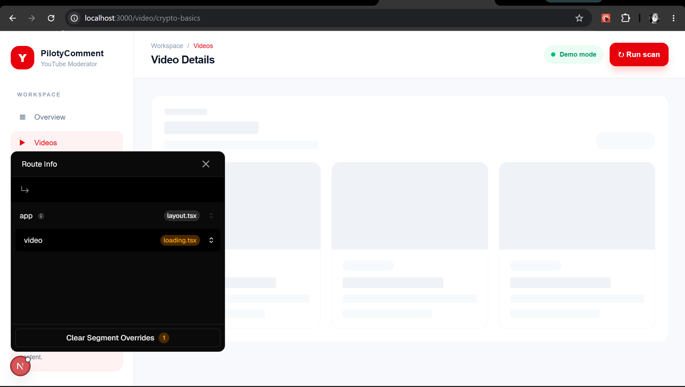
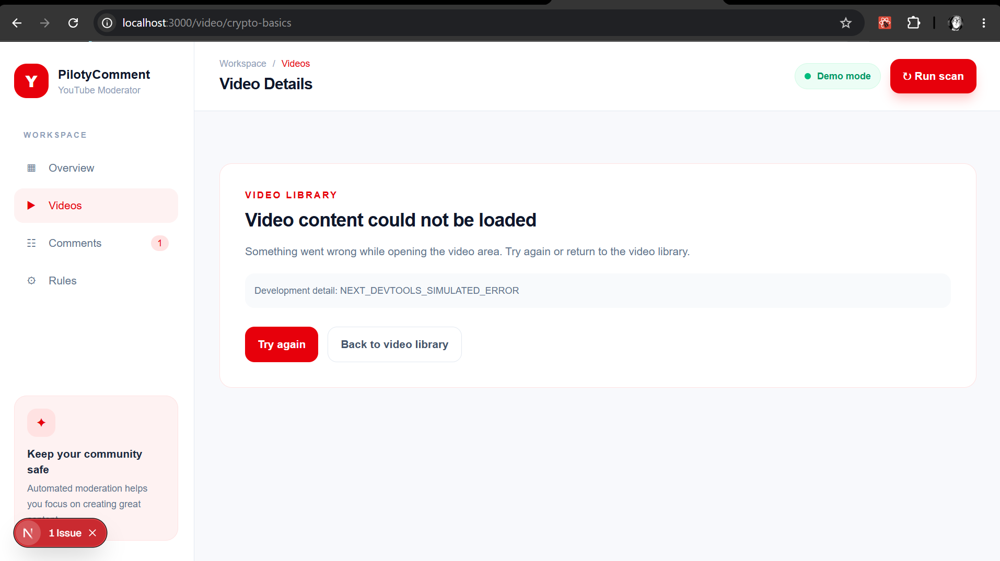
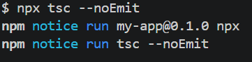
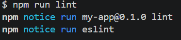

# Dokumen Teknis Modul 4: Next.js App Router

Nama/NIM : Danu Dimas Putra / 105224003

Repositori : [danu44-1/Piloty-Comment](https://github.com/danu44-1/Piloty-Comment) — branch lokal week-4, commit 8b30b57

Versi Next.js dan mode Cache Components (aktif/tidak) : Next.js 16.3.6; Cache Components **tidak aktif**. next.config.ts belum menetapkan cacheComponents: true.

Dasar pengamatan: audit source code, build produksi, dan uji HTTP pada 23 Oktober 2026. Karena proyek menggunakan Next.js 16, params pada dynamic route diperlakukan sebagai Promise dan di-await sebelum digunakan.

## 1. Peta Rute

### Tabel rute

| URL          | Berkas di app/                   | Jenis rute                  | Isi halaman                                                                                                                  |
| ------------ | -------------------------------- | --------------------------- | ---------------------------------------------------------------------------------------------------------------------------- |
| /            | app/page.tsx                     | Static (○)                  | Dashboard overview: ringkasan komentar, video terbaru, aturan moderasi, panduan, dan footer.                                 |
| /comments    | app/comments/page.tsx            | Static (○)                  | Daftar komentar; pencarian, filter, dan perubahan status komentar.                                                           |
| /rules       | app/rules/page.tsx               | Static (○)                  | Konfigurasi aturan moderasi dan pengelolaan kata yang diblokir.                                                              |
| /video       | app/video/page.tsx               | Static (○)                  | Katalog tiga video demo.                                                                                                     |
| /video/[id]  | app/video/[id]/page.tsx          | Dynamic/server-rendered (ƒ) | Detail video berdasarkan id, player placeholder, metadata, dan komentar terkait. ID yang tidak dikenal memanggil notFound(). |
| /\_not-found | Dihasilkan otomatis oleh Next.js | System route                | Entry internal untuk penanganan not-found; UI kustom disediakan oleh app/not-found.tsx.                                      |

app/page1.tsx tidak menjadi route karena bukan file page.tsx; isinya juga berupa implementasi lama yang seluruhnya dikomentari.

### Potongan tabel rute dari keluaran build

Perintah npm run build tidak dapat dipanggil langsung karena instalasi npm global mengarah ke \node_modules\npm\bin\npm-cli.js yang tidak ada. Build yang sama berhasil diverifikasi melalui executable lokal node_modules/.bin/next.cmd build.

```text
Route (app)
┌ ○ /
├ ○ /_not-found
├ ○ /comments
├ ○ /rules
├ ○ /video
└ ƒ /video/[id]

○  (Static)   prerendered as static content
ƒ  (Dynamic)  server-rendered on demand
```

## 2. Layout, Template, dan Berkas Khusus

### Pohon folder app/ akhir

```text
app/
├── not-found.tsx
├── comments/
│   └── page.tsx
├── favicon.ico
├── globals.css
├── layout.tsx
├── page.tsx
├── page1.tsx                 # kode lama terkomentar, bukan route
├── rules/
│   └── page.tsx
└── video/
    ├── error.tsx
    ├── loading.tsx
    ├── page.tsx
    └── [id]/
        ├── not-found.tsx
        └── page.tsx
```

app/layout.tsx adalah root layout. Layout ini menetapkan metadata, font, elemen html/body, ModerationProvider, dan AppShell. AppShell merupakan Client Component sehingga sidebar/header dapat membaca pathname dan menampilkan tab aktif.

Berkas khusus yang relevan pada source tree:

- app/video/loading.tsx — fallback loading untuk segment katalog video.
- app/video/error.tsx — error boundary Client Component untuk segment katalog video.
- app/video/[id]/not-found.tsx — halaman not-found khusus detail video.
- app/not-found.tsx — halaman not-found global.

`app/template.tsx`, `app/error.tsx`, dan `app/global-error.tsx` tidak ditambahkan. Scope produk hanya membutuhkan loading dan error boundary pada katalog video serta halaman not-found global dan detail video.

### Tangkapan layar loading.tsx dan error.tsx

`app/video/loading.tsx` sekarang menyediakan skeleton tiga kartu video, `aria-busy="true"`, dan status aksesibel. `app/video/error.tsx` merupakan Client Component dengan `role="alert"`, tombol Try again yang memanggil `retry()`, tautan kembali ke katalog, serta pesan error teknis yang hanya ditampilkan saat development. Runtime error boundary tidak dipaksa melalui route uji tambahan karena scope produk dibatasi pada `app/` yang sudah ada.


Uji lambat terjadi load dengan preview 3 card


Uji error

## 3. Rute Dinamis dan Validasi params

### Tabel uji HTTP produksi

| URL                        | Hasil yang diharapkan                                                                 | Hasil aktual                                                                               | Kode status curl |
| -------------------------- | ------------------------------------------------------------------------------------- | ------------------------------------------------------------------------------------------ | ---------------: |
| /video/crypto-basics       | Menampilkan detail video valid                                                        | Detail Cryptography Basics for Beginners tampil                                            |              200 |
| /video/web-security        | Menampilkan detail video valid                                                        | Detail Web Security and Safe Browsing tampil                                               |              200 |
| /video/password-protection | Menampilkan detail video valid                                                        | Detail Password Protection with PBKDF2 tampil                                              |              200 |
| /video/unknown             | Menampilkan halaman khusus video tidak ditemukan dan tidak mengungkap detail internal | `app/video/[id]/not-found.tsx` tampil; respons streaming tercatat 200 dan memuat `noindex` |              200 |
| /video/crypto-basics/extra | 404 karena tidak cocok dengan pola route                                              | Route tidak ditemukan                                                                      |              404 |
| /video/                    | Redirect trailing slash ke /video                                                     | Redirect permanen sementara                                                                |              308 |
| /route-does-not-exist      | Menampilkan halaman not-found global                                                  | `app/not-found.tsx` tampil                                                                 |              404 |

Uji dilakukan terhadap server produksi Next.js sementara pada http://localhost:3001 menggunakan curl.exe --path-as-is. Port 3000 sedang digunakan oleh proses lain.

Catatan: karena route detail memiliki `loading.tsx` dan menggunakan `notFound()` setelah proses render dinamis, respons `/video/unknown` dapat sudah mulai di-stream dengan status HTTP 200. UI tetap menampilkan “Video not found” dan metadata `noindex`; hasil ini dicatat apa adanya sesuai perilaku streaming Next.js.

### Aturan validasi params

Implementasi pada app/video/[id]/page.tsx:

1. Next.js menyerahkan params sebagai Promise<{ id: string }>.
2. Halaman melakukan const { id } = await params.
3. getVideoById(id) melakukan pencarian exact match pada initialVideos berdasarkan video.id.
4. ID yang valid saat ini adalah crypto-basics, web-security, dan password-protection.
5. Jika hasil pencarian undefined, halaman memanggil notFound().

Validasi ini bersifat allow-list berbasis data dan case-sensitive. Belum ada validasi format tambahan dengan regex, schema validator, atau generateStaticParams; karena itu build mengklasifikasikan /video/[id] sebagai dynamic/server-rendered.

## 4. Pembagian Server dan Client Components

| Komponen/berkas                                                             | Jenis                  | Alasan teknis                                                                                                               |
| --------------------------------------------------------------------------- | ---------------------- | --------------------------------------------------------------------------------------------------------------------------- |
| app/layout.tsx                                                              | Server Component       | Default App Router; menyediakan metadata, font, root HTML, dan merender provider sebagai child.                             |
| app/page.tsx, app/comments/page.tsx, app/rules/page.tsx, app/video/page.tsx | Server Components      | Tidak memiliki directive use client; tugasnya menyusun route dan komponen halaman.                                          |
| app/video/[id]/page.tsx                                                     | Server Component async | Membaca params, mencari data video, dan menjalankan notFound() di server.                                                   |
| app/video/loading.tsx                                                       | Server Component       | Fallback ringan untuk state loading segment video; tidak membutuhkan state atau event handler client.                       |
| app/video/error.tsx                                                         | Client Component       | Error boundary memerlukan `use client`, `useEffect`, `error`, dan `retry()`; tombol aksi juga membutuhkan event interaktif. |
| app/video/[id]/not-found.tsx                                                | Server Component       | Menyediakan UI not-found yang spesifik untuk detail video dan tetap dapat dirender dari `notFound()`.                       |
| app/not-found.tsx                                                           | Server Component       | Menyediakan fallback global untuk URL yang tidak cocok, tanpa state client.                                                 |
| components/layout/AppShell.tsx                                              | Client Component       | Memakai usePathname() untuk metadata halaman dan navigasi.                                                                  |
| components/moderation/ModerationProvider.tsx                                | Client Component       | Memakai Context, useState, useMemo, dan menyediakan state interaktif ke subtree.                                            |
| components/dashboard/Dashboard.tsx                                          | Client Component       | Membaca useModerationContext() untuk data komentar dan state UI.                                                            |
| components/comments/CommentsPage.tsx                                        | Client Component       | Memakai useMemo, filter, pencarian, dan aksi perubahan status.                                                              |
| components/rules/RulesPage.tsx dan components/rules/KeywordManager.tsx      | Client Components      | Memakai context, input form, toggle, dan event handler.                                                                     |
| components/video/VideoPage.tsx dan components/video/VideoDetail.tsx         | Server Components      | Merender data video; VideoDetail dapat merender child Client Component tanpa harus menjadi Client Component.                |
| lib/data.ts                                                                 | Server-only data layer | Memiliki `import "server-only"`; mengambil data katalog video dan hanya digunakan oleh Server Components.                 |
| lib/data/\*.ts                                                              | Modul data demo        | Menyimpan array demo; belum menjadi query database dan tidak diimpor langsung oleh Client Components.                     |
| lib/utils/video.ts                                                          | Server-only compatibility layer | Meneruskan fungsi ke `lib/data.ts` untuk caller lama dan tetap berada di graph server.                              |

### Hasil uji impor lib/data.ts (server-only) dari Client Component

Uji boundary berhasil dilakukan dengan membuat Client Component probe sementara yang mengimpor `@/lib/data`. Build gagal sesuai harapan dengan pesan bahwa modul yang bergantung pada `server-only` hanya dapat digunakan dari Server Component. Import trace menunjuk ke `app/server-only-probe/page.tsx` lalu `lib/data.ts`.

Probe tersebut langsung dihapus setelah verifikasi dan tidak menjadi route produk. Build final kembali lulus. Di produk, `app/page.tsx`, `app/video/page.tsx`, dan `app/video/[id]/page.tsx` memanggil data layer di server, lalu hanya mengirim object `Video` yang serializable ke Client Components melalui props.

`hooks/useComments.ts` tetap menggunakan data demo client-side dari `lib/data/comments.ts`; modul tersebut belum diberi guard server-only karena fitur komentar saat ini masih dikelola oleh state client.

## 5. Verifikasi

### TypeScript

Perintah yang diminta:

```text
npx tsc --noEmit
Error: Cannot find module 'node_modules\npm\bin\npx-cli.js'
EXIT_CODE=1


```



compiler tidak menghasilkan apapun

Workaround yang memanggil compiler lokal proyek:

```text
node_modules\.bin\tsc.cmd --noEmit
EXIT_CODE=0
```

### Lint

Perintah script npm mengalami masalah lingkungan yang sama:

```text
npm run lint
Error: Cannot find module 'node_modules\npm\bin\npm-cli.js'
EXIT_CODE=1

```



compiler tidak menghasilkan apapun

Verifikasi lint dengan executable lokal berhasil:

```text
node node_modules/eslint/bin/eslint.js app
LINT_EXIT_CODE=0
```

### Build

Perintah script npm juga tidak dapat dimulai karena npm global rusak. Verifikasi produksi menggunakan fallback webpack Next.js setelah Turbopack gagal membuat worker PostCSS pada lingkungan ini:

```text
node_modules\.bin\next.cmd build --webpack
▲ Next.js 16.3.6 (webpack)
✓ Compiled successfully in 2.5s
✓ Generating static pages using 9 workers (7/7) in 1311ms
Route (app)
┌ ○ /
├ ○ /_not-found
├ ○ /comments
├ ○ /rules
├ ○ /video
└ ƒ /video/[id]
○  (Static)   prerendered as static content
ƒ  (Dynamic)  server-rendered on demand
EXIT_CODE=0
```

Build tersebut juga mengompilasi `app/video/loading.tsx`, `app/video/error.tsx`, `app/video/[id]/not-found.tsx`, dan `app/not-found.tsx` tanpa error.

Build Turbopack standar (`next build`) sempat gagal pada worker PostCSS dengan error internal `Failed to write app endpoint /page`; error terjadi pada `app/globals.css` sebelum validasi route. Build webpack berhasil menyelesaikan TypeScript, static generation, dan tabel route yang sama.

Catatan: percobaan build pertama terblokir oleh EACCES saat mengambil Geist dan Geist Mono dari Google Fonts. Setelah akses jaringan diberikan untuk verifikasi, build berhasil tanpa perubahan source code.

## 6. Kendala dan Penyelesaian

1. **npm/npx global tidak tersedia dengan benar.** npm.ps1 menunjuk ke instalasi npm pada AppData\Roaming yang tidak ada. Penyelesaian: gunakan tsc, eslint, dan next dari node_modules/.bin secara langsung.
2. **Build membutuhkan Google Fonts.** app/layout.tsx memakai Geist dan Geist_Mono dari next/font/google. Build awal gagal karena koneksi HTTPS diblokir. Penyelesaian verifikasi: izinkan koneksi saat build; build berikutnya lulus.
3. **Berkas khusus App Router perlu dibatasi sesuai produk.** Penyelesaian: menambahkan `app/video/loading.tsx`, `app/video/error.tsx`, `app/video/[id]/not-found.tsx`, dan `app/not-found.tsx`. `template.tsx`, `/uji`, dan `global-error.tsx` tidak ditambahkan karena tidak diperlukan oleh alur produk dan berada di luar scope.
4. **Perilaku status not-found pada route streaming.** `/video/unknown` mengembalikan status 200 setelah stream dimulai, tetapi UI segment khusus tetap tampil dan respons diberi `noindex`. Hasil tersebut dicatat apa adanya, bukan dipaksa menjadi status lain.
5. **Boundary server/client perlu dijaga.** Penyelesaian: menambahkan `lib/data.ts` dengan `import "server-only"`, memanggilnya dari Server Components, dan meneruskan data video ke Client Components melalui props serializable. Probe import ilegal membuktikan build menolaknya.
6. **Bukti visual belum diarsipkan.** Screenshot sebelum/sesudah navigasi dan screenshot state loading/error masih perlu diambil manual jika diwajibkan untuk pengumpulan.

## 7. Catatan Pemanfaatan AI

AI digunakan untuk membantu membaca instruksi modul, mengaudit App Router, mengimplementasikan berkas khusus pada `app/`, menerapkan server-only data layer, dan memperbarui dokumentasi ini.

| Alat/perintah utama                               | Bagian yang digunakan                                                                                                                  | Cara memverifikasi                                                                        |
| ------------------------------------------------- | -------------------------------------------------------------------------------------------------------------------------------------- | ----------------------------------------------------------------------------------------- |
| Codex/GPT                                         | Membaca instruksi PDF, memetakan struktur App Router, merancang UI product-aligned untuk loading/error/not-found, menerapkan DAL server-only, dan menyusun laporan | Bandingkan setiap klaim dengan source code pada `app/`, `lib/data.ts`, tabel, dan pohon folder. |
| PowerShell Get-ChildItem, rg --files, Get-Content | Inventarisasi app/, komponen, konfigurasi, dan berkas khusus                                                                           | Ulangi perintah pada root repositori dan cek keberadaan setiap path.                      |
| node_modules/.bin/tsc.cmd --noEmit                | Verifikasi tipe TypeScript                                                                                                             | Exit code 0.                                                                              |
| node node_modules/eslint/bin/eslint.js app        | Verifikasi lint pada perubahan App Router                                                                                              | Exit code 0.                                                                              |
| node_modules/.bin/next.cmd build --webpack        | Verifikasi build produksi, server-only boundary, dan tabel route                                                                      | Exit code 0 dan cocokkan keluaran Route (app).                                            |
| next start -p 3013 + curl.exe                    | Verifikasi server produksi dan status route video/not-found                                                                            | `/video/crypto-basics` 200, `/video/unknown` 200 + UI/noindex, URL tidak dikenal 404.     |

AI menambahkan data layer `lib/data.ts`, menyesuaikan alur props Server-to-Client, menambahkan dependency `server-only`, dan memperbarui dokumentasi ini; tidak melakukan commit atau push. Screenshot dan field Nama/NIM tetap perlu dilengkapi secara manual jika diperlukan untuk pengumpulan.
