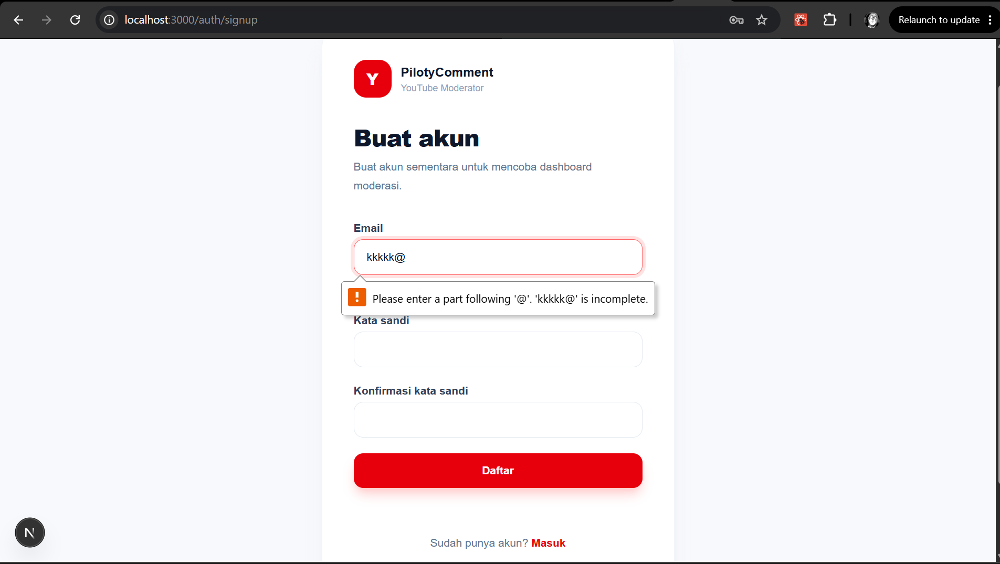
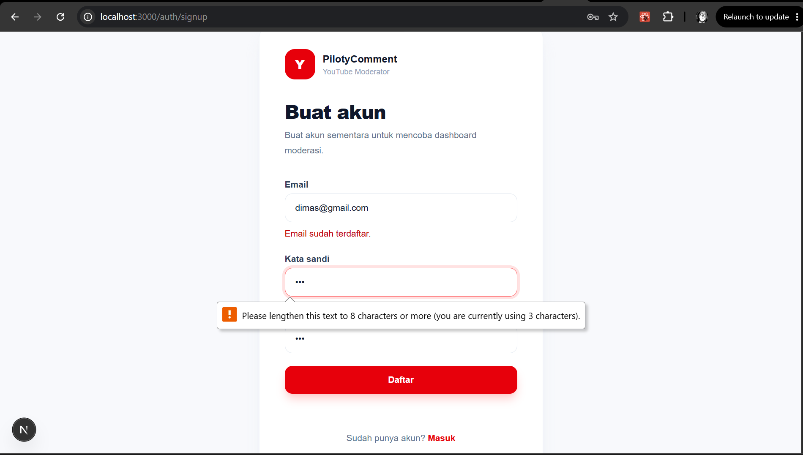
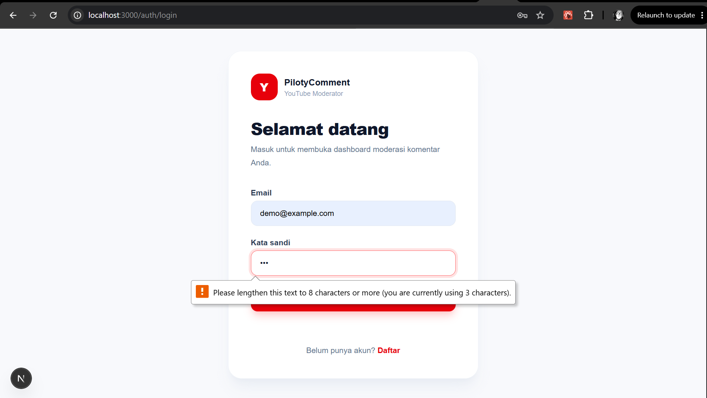
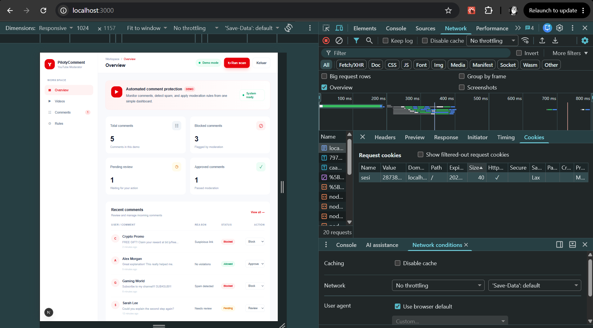
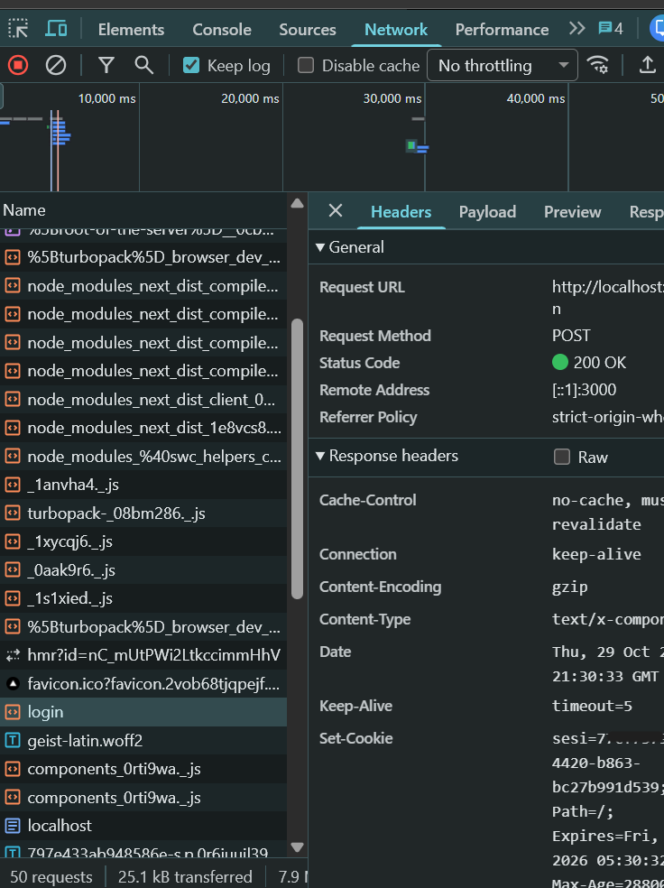
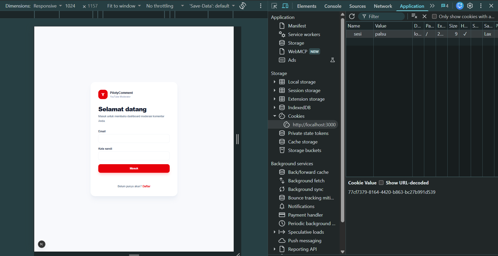

# Dokumen Teknis Modul 5 — Formulir, Validasi, Session, dan Cookie

Nama/NIM : Danu Dimas Putra / 105224003

Repositori : [danu44-1/Piloty-Comment](https://github.com/danu44-1/Piloty-Comment/tree/week-5) — branch `week-5`

Versi yang diamati: Next.js 16.3.6, React 19, dan Zod 4.6.7. Implementasi login berada pada `/auth/login`, sedangkan pendaftaran berada pada `/auth/signup`.

## 1. Skema Validasi

Skema disimpan terpisah dari Server Action agar aturan bentuk formulir dapat digunakan dan diuji secara konsisten:

- `lib/scheme/login.ts` — `skemaMasuk`
- `lib/scheme/signup.ts` — `skemaDaftar`

### Tabel kolom formulir

| Formulir | Nama kolom | Aturan Zod | Pesan galat |
| --- | --- | --- | --- |
| Login | `email` | String, `trim()`, tidak boleh kosong, harus berformat email | `Email wajib diisi.` / `Format email tidak valid.` |
| Login | `kataSandi` | String, minimal 8 karakter | `Kata sandi wajib diisi.` / `Kata sandi minimal 8 karakter.` |
| Sign up | `email` | String, `trim()`, tidak boleh kosong, harus berformat email | `Email wajib diisi.` / `Format email tidak valid.` |
| Sign up | `kataSandi` | String, minimal 8 karakter | `Kata sandi wajib diisi.` / `Kata sandi minimal 8 karakter.` |
| Sign up | `konfirmasiKataSandi` | String, tidak boleh kosong | `Konfirmasi kata sandi wajib diisi.` |
| Sign up | pasangan password | `kataSandi` harus sama dengan `konfirmasiKataSandi` melalui `.refine()` | `Konfirmasi kata sandi tidak cocok.` |

### Aturan semantik di Server Action

Validasi bentuk hanya memastikan struktur dan tipe nilai. Aturan berikut tetap diperiksa di server karena tidak dapat dipercaya jika hanya diletakkan di HTML atau Client Component:

1. Login memeriksa apakah email dan password cocok dengan akun melalui `verifikasiAkun()`.
2. Sign up memeriksa apakah email sudah digunakan melalui `buatAkun()`. Email yang sama ditolak dengan pesan `Email sudah terdaftar.`.
3. Password baru disimpan sebagai hash `scrypt` dengan salt acak di `lib/data/account.ts`, bukan sebagai plaintext.
4. Server Action selalu membaca `FormData` dan menjalankan `safeParse()`, sehingga pemeriksaan tetap berlaku walaupun atribut validasi HTML dihapus melalui DevTools.

## 2. Alur Server Action

### Login

Urutan proses pada `app/auth/login/actions.ts` adalah:

1. Menerima `FormData` dari `FormMasuk`.
2. Menjalankan validasi bentuk dengan `skemaMasuk.safeParse()`.
3. Jika gagal, mengembalikan `fieldErrors` dari `z.flattenError()` ke form.
4. Jika bentuk benar, memeriksa password terhadap hash akun dengan `verifikasiAkun()`.
5. Jika kredensial benar, `buatSesi()` membuat session ID acak dan cookie `sesi`.
6. Mengarahkan pengguna ke `/` dengan `redirect("/")`.

### Sign up

Urutan proses pada `app/auth/signup/actions.ts` adalah:

1. Menerima `FormData` dari `FormDaftar`.
2. Menjalankan validasi bentuk dan validasi semantik kesamaan password melalui `skemaDaftar.safeParse()`.
3. Jika gagal, mengembalikan galat per kolom tanpa menyimpan password kembali ke state form.
4. Memeriksa duplikasi email dan membuat akun baru melalui `buatAkun()`.
5. Menyimpan akun sementara dalam `Map` global proses dengan password yang sudah di-hash.
6. Mengarahkan pengguna ke `/auth/login?terdaftar=1`.

### Logout dan `revalidatePath`

`keluar()` pada `app/auth/login/actions.ts` menghapus session dari `Map`, menghapus cookie `sesi`, lalu melakukan redirect ke `/auth/login`.

`revalidatePath` belum digunakan. Alasannya, login, logout, dan sign up pada fase ini hanya mengubah session atau penyimpanan akun sementara di memori; tidak ada daftar produk atau data database yang perlu direvalidasi. Redirect sudah cukup untuk merender halaman tujuan dengan state request terbaru.

### Pembagian berkas

| Berkas | Jenis | Tanggung jawab |
| --- | --- | --- |
| `app/auth/login/page.tsx` | Server Component | Merender halaman login dan membaca session yang sudah ada. |
| `app/auth/signup/page.tsx` | Server Component | Merender halaman pendaftaran. |
| `components/FormMasuk.tsx` | Client Component | Menampilkan input login, error per kolom, status pending, dan `useActionState`. |
| `components/FormDaftar.tsx` | Client Component | Menampilkan input sign up, error per kolom, status pending, dan `useActionState`. |
| `app/auth/login/actions.ts` | Server Action | Validasi login, pembuatan session, dan logout. |
| `app/auth/signup/actions.ts` | Server Action | Validasi pendaftaran dan pembuatan akun sementara. |
| `lib/scheme/login.ts` | Shared validation module | Skema login Zod. |
| `lib/scheme/signup.ts` | Shared validation module | Skema sign up Zod. |
| `lib/data/account.ts` | Server-only data module | Penyimpanan akun sementara dan verifikasi hash password. |
| `lib/scheme/session.ts` | Server-only session module | Membuat, membaca, memvalidasi, dan menghapus session. |

## 3. Bukti Uji Validasi

Pengujian skema berikut dijalankan langsung terhadap `safeParse()` dengan Node TypeScript strip mode. Kasus dengan kolom `novalidate` mensimulasikan atribut `novalidate` yang ditambahkan manual melalui DevTools; atribut tersebut tidak disimpan pada source code produksi.

| No. | Form dan masukan | Validasi klien dilewati | Hasil yang diharapkan | Hasil nyata |
| ---: | --- | :---: | --- | --- |
| 1 | Login: `demo@example.com`, `PilotyDemo123!` | Tidak | Skema valid; kredensial dummy membuat session dan redirect ke `/` | `safeParse` berhasil. Jalur Server Action memanggil `verifikasiAkun`, `buatSesi`, lalu `redirect("/")`. |
| 2 | Login: email `demo` | Tidak | Galat pada `email` | `email: Format email tidak valid.` |
| 3 | Login: password `123` | Tidak | Galat pada `kataSandi` | `kataSandi: Kata sandi minimal 8 karakter.` |
| 4 | Login: email valid tetapi password salah | Tidak | Pesan umum dan tidak membuat session | Server Action mengembalikan `Email atau kata sandi salah.` |
| 5 | Sign up: `baru@example.com`, `Rahasia123!`, konfirmasi sama | Tidak | Akun dibuat dan diarahkan ke `/auth/login?terdaftar=1` | `safeParse` berhasil; `buatAkun()` membuat entry baru dan action melakukan redirect. |
| 6 | Sign up: email `demo@example.com` yang sudah digunakan | Tidak | Email ditolak sebagai duplikat | `buatAkun()` mengembalikan `false`; galat `Email sudah terdaftar.` |
| 7 | Sign up: password `123`, konfirmasi `123` | Ya | Server tetap menolak password pendek | `kataSandi: Kata sandi minimal 8 karakter.` |
| 8 | Sign up: password `Rahasia123!`, konfirmasi `Beda12345!` | Ya | Server menolak password yang berbeda | `konfirmasiKataSandi: Konfirmasi kata sandi tidak cocok.` |
| 9 | Sign up: email kosong, password valid | Ya | Server menolak email kosong | `email: Email wajib diisi.` |

### Tangkapan layar galat per kolom

- 
- 
- 
- 

Setiap screenshot harus menampilkan pesan di bawah kolom yang sesuai serta atribut aksesibilitas `aria-invalid` dan `aria-describedby`.

## 4. Session dan Cookie

### Atribut cookie sesi

| Atribut | Nilai | Alasan |
| --- | --- | --- |
| Nama | `sesi` | Nama pendek untuk ID session server. |
| `HttpOnly` | `true` | Mencegah JavaScript membaca ID session melalui `document.cookie`. |
| `Secure` | `true` saat production, `false` saat development | Cookie production hanya dikirim melalui HTTPS; localhost tetap dapat diuji tanpa HTTPS. |
| `SameSite` | `lax` | Mengurangi pengiriman cookie pada request lintas situs dan membantu mitigasi CSRF. |
| `Path` | `/` | Session berlaku untuk seluruh route aplikasi. |
| `Max-Age` | `28800` detik | Session aktif maksimal 8 jam dari saat dibuat. |

Cookie hanya menyimpan ID acak. Email dan waktu kedaluwarsa disimpan dalam `Map` server melalui `globalThis.__pilotyCommentSesi`.

### Bentuk header Set-Cookie yang diharapkan

Nilai ID disamarkan pada screenshot. Bentuk header yang diharapkan pada development adalah:

~~~text
Set-Cookie: sesi=[NILAI_DISAMARKAN]; Path=/; Max-Age=28800; HttpOnly; SameSite=Lax
~~~

Pada production, header juga memuat atribut `Secure`.

### Hasil uji session

1. **Cookie tidak ada:** `proxy.ts` mengembalikan redirect `307` ke `/auth/login` untuk route protected seperti `/`, `/comments`, `/rules`, dan `/video`.
2. **Cookie palsu:** proxy hanya memeriksa keberadaan cookie, tetapi `wajibSesi()` membaca ID tersebut dari `Map`. Karena ID palsu tidak ditemukan, request diarahkan ke `/auth/login`.
3. **Logout:** `hapusSesi()` menghapus entry session dari `Map` dan menjalankan `cookies().delete("sesi")`.
4. **Cookie lama setelah logout:** walaupun nilai cookie lama dikirim ulang secara manual, ID tersebut sudah tidak ada di `Map`, sehingga `bacaSesi()` mengembalikan `null` dan akses ditolak.

### Tangkapan layar Application dan Network

-  — panel Application/Cookies dengan nilai `sesi` disamarkan.
-  — header `Set-Cookie` pada response login dengan nilai disamarkan.
- ` — response redirect ketika cookie dihapus atau dipalsukan.

## 5. Keputusan Teknis

### Session di server dibanding token di cookie

Produk memilih session ID acak yang dipetakan ke data session di server karena:

- cookie tidak memuat email atau data pengguna;
- session dapat dicabut saat logout dengan menghapus entry server;
- cookie dilindungi `HttpOnly` dan `SameSite`;
- validasi kedaluwarsa dilakukan di server;
- implementasi mudah diganti ke database atau Redis pada tahap berikutnya.

Batasannya, `Map` hanya berlaku pada satu proses Node.js dan seluruh akun/session sementara hilang ketika server restart. Pola ini hanya untuk fase praktikum, bukan penyimpanan production.

### Batas peran `proxy.ts`

`proxy.ts` adalah pemeriksaan optimistik. Ia hanya memastikan cookie `sesi` tersedia sebelum route dilanjutkan. Proxy tidak menjadi sumber kebenaran session karena cookie dapat dipalsukan.

Pemeriksaan yang menentukan tetap berada di `wajibSesi()` dan Server Action. Lapisan ini memeriksa ID terhadap `Map`, memeriksa kedaluwarsa, dan mengarahkan pengguna tanpa session valid ke `/auth/login`.

## 6. Kendala dan Penyelesaian

1. **Penyimpanan akun belum menggunakan database.** Penyelesaian sementara adalah `Map` server-only pada `lib/data/account.ts`, dengan password hash `scrypt` dan salt acak.
2. **Session dan akun hilang saat server restart.** Hal ini diterima untuk fase praktikum; tahap berikutnya perlu persistent storage.
3. **Validasi HTML dapat dilewati.** Server Action tetap menjalankan Zod `safeParse()` sehingga input `novalidate` tidak dapat melewati validasi server.
4. **Proxy dapat dilewati dengan cookie palsu.** Pemeriksaan authoritative dilakukan lagi oleh `wajibSesi()` pada Server Component.
5. **Perintah global `npm`/`npx` pada lingkungan pengembangan dapat bermasalah.** Verifikasi dilakukan dengan executable lokal seperti `node node_modules/typescript/bin/tsc --noEmit` dan `node node_modules/eslint/bin/eslint.js .`.

## 7. Catatan Pemanfaatan AI

AI digunakan untuk membaca instruksi Modul 5, mengaudit struktur App Router, membantu implementasi login/sign up, menyusun skema Zod, session cookie, proxy, dan dokumentasi teknis ini.

| Alat/perintah utama | Bagian yang digunakan | Cara memverifikasi |
| --- | --- | --- |
| Codex/GPT | Membantu memetakan requirement modul ke `app/auth`, `lib/scheme`, `lib/data`, dan komponen form | Bandingkan setiap klaim dengan source code pada path yang disebutkan. |
| PowerShell `Get-Content`, `Get-ChildItem`, dan `rg` | Audit branch, struktur direktori, referensi route lama, dan isi berkas | Ulangi perintah dari root repositori dan pastikan tidak ada referensi `/masuk` atau `/daftar` yang tersisa. |
| `node --experimental-strip-types` | Menjalankan delapan kasus `safeParse()` untuk login dan sign up | Cocokkan output `berhasil` dan `fieldErrors` dengan tabel uji pada Bagian 3. |
| `node node_modules/typescript/bin/tsc --noEmit` | Verifikasi tipe TypeScript setelah pemindahan route ke `app/auth` | Exit code `0`. |
| `node node_modules/eslint/bin/eslint.js .` | Verifikasi lint seluruh source | Exit code `0`. |
| `node node_modules/next/dist/bin/next typegen` | Membuat ulang route types setelah rename route | Pesan `Types generated successfully`. |
| `node node_modules/next/dist/bin/next dev` dan `HttpClient` PowerShell | Smoke test route baru dan route lama | `/auth/login` dan `/auth/signup` menghasilkan `200`; `/masuk` dan `/daftar` menghasilkan `404`; route protected tanpa cookie diarahkan ke `/auth/login`. |
