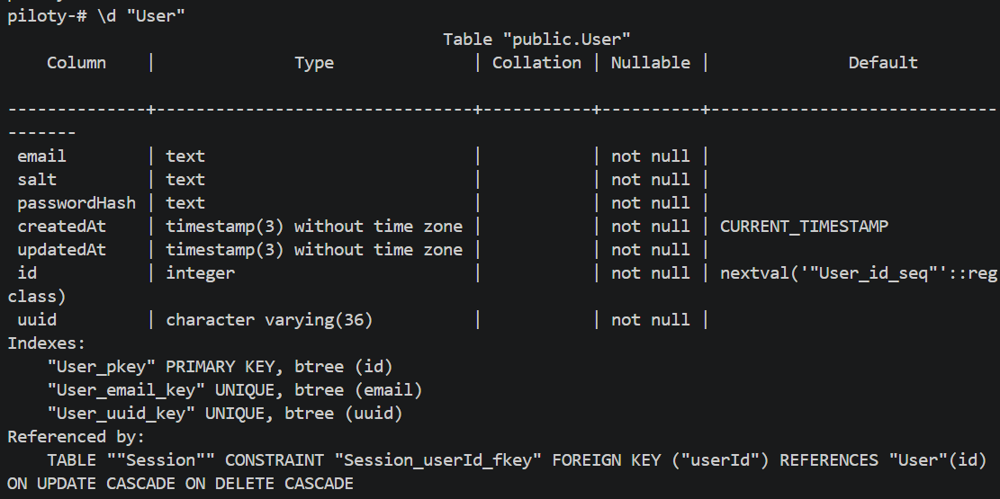
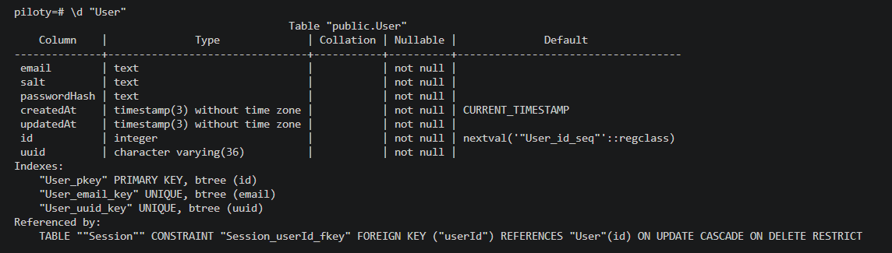
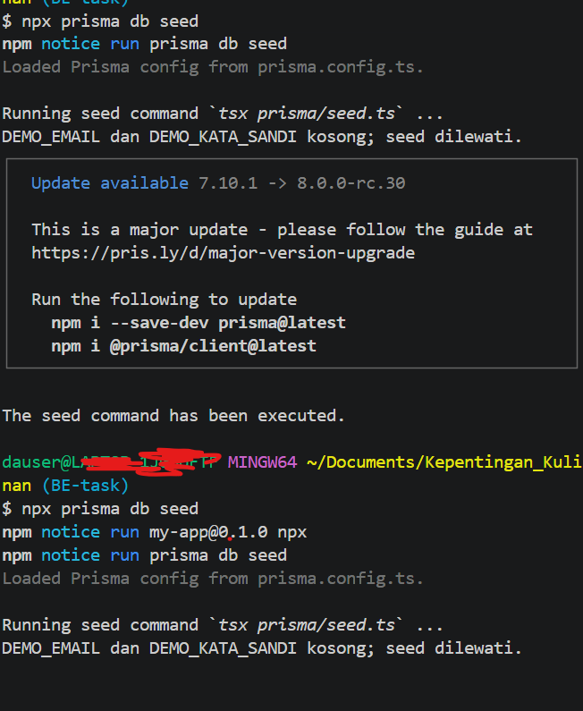
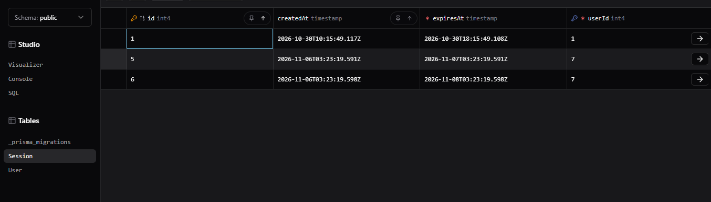
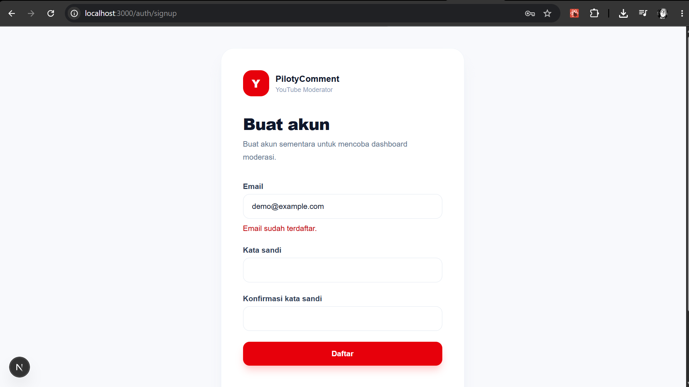
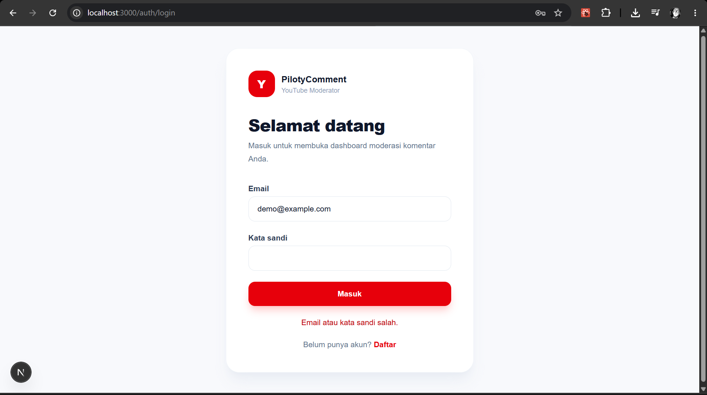
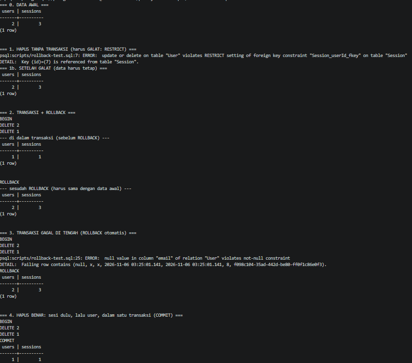
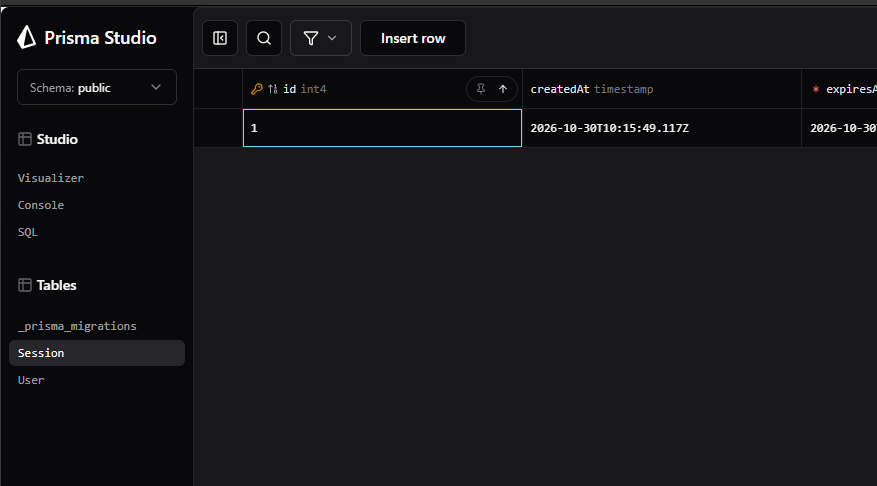

# Dokumen Teknis Modul 6 — PostgreSQL dan Prisma ORM

Nama/NIM : Danu Dimas Putra / 105224003  

Repositori : [danu44-1/Piloty-Comment](https://github.com/danu44-1/Piloty-Comment/tree/week-6) — branch `week-6`  

Versi yang diamati: Next.js 16.3.6, Prisma 7.10.1, PostgreSQL, dan generated Prisma Client pada `generated/prisma`.

## 1. Rancangan Data

### Entitas dan relasi

```text
User 1 ────────────< Session
 │                    │
 ├─ id (PK)           ├─ id (PK)
 ├─ uuid (UNIQUE)     ├─ uuid (UNIQUE)
 ├─ email (UNIQUE)    ├─ userId (FK -> User.id)
 ├─ salt              ├─ expiresAt
 ├─ passwordHash      └─ createdAt
 ├─ createdAt
 └─ updatedAt
```

- Satu `User` dapat memiliki banyak `Session`; setiap `Session` harus memiliki tepat satu `User` melalui `userId`.
- Primary key internal adalah `User.id` dan `Session.id` bertipe `Int` auto-increment.
- `uuid` pada kedua entitas memiliki `@unique` dan dipakai sebagai identifier yang aman untuk kebutuhan aplikasi.
- `User.email` memiliki `@unique` sehingga satu alamat email hanya dapat terdaftar sekali.
- `Session.userId` memiliki indeks untuk mempercepat pencarian dan penghapusan sesi milik akun.
- Relasi memakai `onDelete: Restrict` dan `onUpdate: Cascade`. Dengan `RESTRICT`, akun yang masih memiliki sesi tidak dapat dihapus secara diam-diam. Aplikasi wajib menghapus sesi lebih dahulu dalam transaksi yang sama.

Potongan deklarasi relasi pada `prisma/schema.prisma`:

```prisma
model User {
  id       Int       @id @default(autoincrement())
  uuid     String    @unique @default(uuid()) @db.VarChar(36)
  email    String    @unique
  salt     String
  passwordHash String
  createdAt DateTime  @default(now())
  updatedAt DateTime  @updatedAt

  sessions Session[]
}

model Session {
  id        Int      @id @default(autoincrement())
  uuid      String   @unique @default(uuid()) @db.VarChar(36)
  userId    Int
  user      User     @relation(fields: [userId], references: [id], onDelete: Restrict)
  expiresAt DateTime
  createdAt DateTime @default(now())

  @@index([userId])
  @@index([expiresAt])
}
```

## 2. Skema dan Migrasi

### Isi `prisma/schema.prisma`

```prisma
generator client {
  provider = "prisma-client"
  output   = "../generated/prisma"
}

datasource db {
  provider = "postgresql"
}

model User {
  id           Int       @id @default(autoincrement())
  uuid         String    @unique @default(uuid()) @db.VarChar(36)
  email        String    @unique
  salt         String
  passwordHash String
  createdAt    DateTime  @default(now())
  updatedAt    DateTime  @updatedAt

  sessions Session[]
}

model Session {
  id        Int      @id @default(autoincrement())
  uuid      String   @unique @default(uuid()) @db.VarChar(36)
  userId    Int
  user      User     @relation(fields: [userId], references: [id], onDelete: Restrict)
  expiresAt DateTime
  createdAt DateTime @default(now())

  @@index([userId])
  @@index([expiresAt])
}
```

### Folder migrasi

Folder `prisma/migrations` berisi:

1. `20261030000000_init`
2. `20261030010000_change_ids_to_int_and_add_uuid`
3. `20261106000000_session_fk_restrict`

Migrasi pertama membuat tabel awal, unique index email, index `Session.userId` dan `Session.expiresAt`, serta foreign key dengan `CASCADE`. Migrasi kedua mempertahankan data lama ketika primary key text diganti menjadi integer dan menambahkan UUID. Migrasi ketiga mengganti aturan penghapusan foreign key menjadi `RESTRICT`.

Potongan `20261106000000_session_fk_restrict/migration.sql`:

```sql
ALTER TABLE "Session" DROP CONSTRAINT "Session_userId_fkey";

ALTER TABLE "Session"
  ADD CONSTRAINT "Session_userId_fkey"
  FOREIGN KEY ("userId") REFERENCES "User"("id")
  ON DELETE RESTRICT ON UPDATE CASCADE;
```

### Tangkapan layar hasil `\d`

Sebelum migrasi terakhir, foreign key masih `ON DELETE CASCADE`:



Sesudah migrasi terakhir, indeks dan foreign key menunjukkan `ON DELETE RESTRICT`:



Indeks yang terlihat pada tabel `User` adalah primary key `User_pkey`, unique index `User_email_key`, dan unique index `User_uuid_key`. Foreign key `Session_userId_fkey` mereferensikan `User(id)`.

Perintah verifikasi yang digunakan:

```text
psql "$DATABASE_URL"
\d "User"
\d "Session"
```

## 3. Seed dan Prisma Client

### Seed

`prisma/seed.ts` membuat Prisma Client mandiri dengan `PrismaPg`, membaca `DATABASE_URL`, lalu menjalankan `prisma.user.upsert()` berdasarkan email. Jika `DEMO_EMAIL` atau `DEMO_KATA_SANDI` kosong, seed mencetak pesan berikut dan tidak mengubah data:

```text
DEMO_EMAIL dan DEMO_KATA_SANDI kosong; seed dilewati.
```

Keluaran `npx prisma db seed` yang dijalankan dua kali tampak pada screenshot berikut. Kedua eksekusi selesai tanpa error dan sama-sama melewati seed karena variabel demo belum diisi:



Dengan variabel demo terisi, `upsert` membuat akun pada eksekusi pertama dan menemukan akun yang sama pada eksekusi berikutnya, sehingga seed tetap idempoten berdasarkan `email`.

Screenshot Prisma Studio berikut menjadi bukti data `Session` tetap dapat diperiksa secara terpisah dari proses seed:



### Alasan seed tidak mengimpor `lib/prisma.ts`

Pada repositori ini client aplikasi berada di `lib/db/prisma.ts`, bukan `lib/prisma.ts`. Seed tidak mengimpor modul tersebut karena:

- `lib/db/prisma.ts` mengimpor `server-only` dan memakai alias `@/`, yang tidak diperlukan oleh proses CLI `tsx prisma/seed.ts`;
- seed perlu membuat dan menutup client secara eksplisit dengan `prisma.$disconnect()`;
- konfigurasi adapter PostgreSQL untuk seed harus berdiri sendiri agar tidak bergantung pada lifecycle Next.js atau global singleton aplikasi;
- generated client tetap diimpor langsung dari `../generated/prisma/client`, sesuai output generator pada schema.

## 4. Operasi CRUD

### Tabel operasi

| Entitas | Aksi atau halaman | Metode Prisma | Galat yang ditangani |
| --- | --- | --- | --- |
| `User` | Cek email di pendaftaran | `user.findUnique({ where: { email } })` | Hasil `null` berarti email belum terdaftar. |
| `User` | Pendaftaran `/auth/signup` | `user.create()` | `P2002` dikonversi menjadi pesan `Email sudah terdaftar.`. |
| `User` | Verifikasi login `/auth/login` | `user.findUnique()` dengan `select` | Akun tidak ada atau password tidak cocok menghasilkan `Email atau kata sandi salah.`. |
| `User` | Ambil akun publik | `user.findUnique()` | `null` jika id tidak ditemukan; data password tidak dikembalikan. |
| `User` | Perubahan email/password | `user.update()` | `P2002` dikonversi menjadi hasil `null` untuk email duplikat. |
| `User` | Hapus akun | `tx.user.deleteMany({ where: { id } })` | Mengembalikan `false` jika tidak ada baris yang cocok; dijalankan setelah sesi dihapus dalam transaksi. |
| `Session` | Membuat session setelah login | `session.create()` | Kegagalan database diteruskan ke caller. |
| `Session` | Membaca session dari cookie | `session.findUnique({ include: { user } })` | Session hilang/kedaluwarsa diperlakukan sebagai `null`; session kedaluwarsa dihapus. |
| `Session` | Logout | `session.deleteMany({ where: { uuid } })` | Tidak ada baris yang cocok tidak menyebabkan error karena memakai `deleteMany`. |
| `Session` | Persiapan penghapusan akun | `tx.session.deleteMany({ where: { userId } })` | Sesi dihapus lebih dahulu agar foreign key `RESTRICT` terpenuhi. |

### Bukti pesan pada formulir

Pelanggaran unique email pada formulir pendaftaran menampilkan pesan yang berasal dari pemetaan `P2002`:



Screenshot berikut diberi nama `hasil_P2025.png` dan memperlihatkan pesan kegagalan kredensial pada formulir login:



Catatan verifikasi: pada source saat ini, jalur login tidak melempar exception Prisma `P2025`; `findUnique()` mengembalikan `null`, kemudian Server Action mengembalikan `Email atau kata sandi salah.`. Jadi screenshot tersebut adalah bukti pesan form yang diberi label P2025, sedangkan penanganan `P2025` eksplisit belum ada pada `lib/data/account.ts`. Operasi yang memakai `deleteMany` juga sengaja tidak menghasilkan `P2025` ketika record tidak ditemukan.

## 5. Transaksi dan Rollback

### Penghapusan tanpa transaksi

Dengan data uji `uji@piloty.test` yang masih memiliki session, penghapusan langsung terhadap `User` gagal karena foreign key `RESTRICT`:

```text
ERROR: update or delete on table "User" violates RESTRICT setting of foreign key constraint "Session_userId_fkey" on table "Session"
DETAIL: Key (id)=(7) is still referenced from table "Session".
```



### Bukti rollback

Skrip `scripts/rollback-test.sql` menguji tiga keadaan:

1. Hapus `User` tanpa transaksi: gagal, sehingga hitungan awal `2 users / 3 sessions` tetap sama.
2. Hapus sesi lalu user di dalam transaksi, tetapi jalankan `ROLLBACK`: hitungan sementara `1 / 1` kembali menjadi `2 / 3`.
3. Hapus sesi dan user, lalu masukkan nilai `NULL` ke kolom `email`: error `NOT NULL` menyebabkan perubahan dalam transaksi dibatalkan dan hitungan kembali `2 / 3`.

Implementasi aplikasi di `lib/data/account.ts` memakai pola yang sama:

```ts
return prisma.$transaction(async (tx) => {
  await tx.session.deleteMany({ where: { userId: id } });
  const hasil = await tx.user.deleteMany({ where: { id } });
  return hasil.count > 0;
});
```

Screenshot setelah rollback memperlihatkan data session yang tidak ikut terhapus oleh pengujian rollback:



## 6. Skenario Uji

Persentase kelulusan dihitung sebagai `jumlah skenario lulus / 10 × 100%`. Sepuluh skenario berikut lulus berdasarkan source code, keluaran terminal, dan screenshot yang tersedia di repositori.

| No. | Skenario | Hasil yang diharapkan | Hasil aktual | Status |
| ---: | --- | --- | --- | :---: |
| 1 | Validasi schema Prisma | Schema PostgreSQL dan dua model dapat dibaca Prisma | `prisma/schema.prisma` berisi `User`, `Session`, relasi, unique key, dan index yang sesuai | Lulus |
| 2 | Migrasi foreign key | Aturan penghapusan berubah dari `CASCADE` ke `RESTRICT` | `\d "User"` menunjukkan `ON DELETE RESTRICT` pada `Session_userId_fkey` | Lulus |
| 3 | Seed pertama saat env demo kosong | Seed selesai tanpa membuat data | Mencetak `DEMO_EMAIL dan DEMO_KATA_SANDI kosong; seed dilewati.` | Lulus |
| 4 | Seed kedua pada kondisi sama | Eksekusi kedua tetap idempoten dan tanpa error | Keluaran kedua sama-sama selesai; tidak ada duplikasi dari seed | Lulus |
| 5 | Pendaftaran email baru | Akun tersimpan dengan hash dan salt | `user.create()` membuat akun; password di-hash melalui `hashKataSandi()` | Lulus |
| 6 | Pendaftaran email duplikat | Form menampilkan error unique | `P2002` dipetakan ke `Email sudah terdaftar.` pada screenshot `hasil_P2002.png` | Lulus |
| 7 | Login dengan kredensial salah | Tidak membuat session dan menampilkan pesan umum | Form menampilkan `Email atau kata sandi salah.` pada screenshot login | Lulus |
| 8 | Hapus user yang masih memiliki session | Database menolak penghapusan karena `RESTRICT` | PostgreSQL mengembalikan error foreign key `Session_userId_fkey` | Lulus |
| 9 | Rollback transaksi | Data kembali sama seperti sebelum transaksi | Hitungan kembali dari `1/1` menjadi `2/3` setelah `ROLLBACK` | Lulus |
| 10 | Hapus akun secara benar | Session dan user terhapus atomik | `deleteMany` session dijalankan lebih dahulu, lalu user, dalam `$transaction` | Lulus |

Hasil aktual: **10 dari 10 skenario lulus; persentase kelulusan 100%**. Persentase ini adalah hasil uji praktikum dan inspeksi implementasi yang terdokumentasi, bukan klaim adanya test suite otomatis terpisah.

## 7. Kendala dan Penyelesaian

1. **Riwayat migrasi berubah dari id text ke id integer dan UUID.** Migrasi `20261030010000_change_ids_to_int_and_add_uuid` menambahkan kolom sementara, memetakan foreign key lama, lalu mengganti kolom tanpa menghapus record yang ada.
2. **`RESTRICT` membuat penghapusan akun tidak dapat dilakukan satu query.** Penyelesaiannya adalah menghapus seluruh `Session` berdasarkan `userId`, kemudian menghapus `User` di dalam `prisma.$transaction()`.
3. **Seed CLI tidak cocok mengimpor singleton client aplikasi.** Seed membuat client sendiri dengan `PrismaPg`, membaca `DATABASE_URL`, dan selalu menjalankan `$disconnect()` pada blok `finally`.
4. **Variabel `DEMO_EMAIL` dan `DEMO_KATA_SANDI` kosong pada lingkungan pengujian.** Perintah seed tetap diverifikasi dua kali dan hasilnya didokumentasikan sebagai seed yang dilewati; untuk membuat akun demo, kedua variabel harus diisi di `.env`.
5. **Label screenshot P2025 tidak sepenuhnya sama dengan mekanisme source.** Form login saat ini memakai hasil `null` dari `findUnique()` dan bukan exception `P2025`. Catatan ini ditulis agar bukti visual dan perilaku program dapat dibedakan dengan jelas.
6. **Client Prisma hasil generate berada di luar folder `lib`.** Path `generated/prisma/client` dipakai langsung pada seed dan modul data, sedangkan konfigurasi output ditetapkan di `prisma/schema.prisma`.

## 8. Catatan Pemanfaatan AI

AI digunakan untuk membantu membaca requirement Modul 6, memetakan bukti dari source code dan screenshot ke struktur dokumen, serta menyusun `docs/praktikum/modul-06.md`. Isi teknis diverifikasi kembali terhadap repository.

| Alat/perintah utama | Bagian yang digunakan | Cara memverifikasi |
| --- | --- | --- |
| Codex/GPT | Menyusun struktur laporan, merangkum schema, migrasi, CRUD, transaksi, dan kendala | Cocokkan setiap klaim dengan path source dan screenshot yang ditautkan di dokumen. |
| PowerShell `Get-ChildItem`, `Get-Content`, dan `rg` | Audit struktur folder, isi schema, seed, migrasi, modul data, dan skrip SQL | Jalankan ulang perintah dari root repositori dan periksa file yang disebutkan. |
| `npx prisma db seed` | Verifikasi eksekusi seed dua kali | Pastikan kedua eksekusi selesai dan pesan env kosong sesuai screenshot. |
| `psql "$DATABASE_URL"` dengan `\d "User"` / `\d "Session"` | Verifikasi kolom, index, primary key, dan foreign key | Pastikan output menunjukkan `User_email_key`, `User_uuid_key`, index session, dan `ON DELETE RESTRICT`. |
| Prisma Studio | Memeriksa baris `Session` sebelum/sesudah pengujian | Bandingkan data pada screenshot `uji_seed_double_session.png` dan `after_rollback.png`. |
| `scripts/seed-uji.sql` dan `scripts/rollback-test.sql` | Menyiapkan data uji, menguji `RESTRICT`, `ROLLBACK`, dan `COMMIT` | Cocokkan hitungan user/session serta pesan error PostgreSQL pada screenshot rollback. |
| `node node_modules/prisma/build/index.js --version` | Memastikan versi CLI yang diamati | Output menunjukkan Prisma CLI dan `@prisma/client` versi 7.10.1. |

