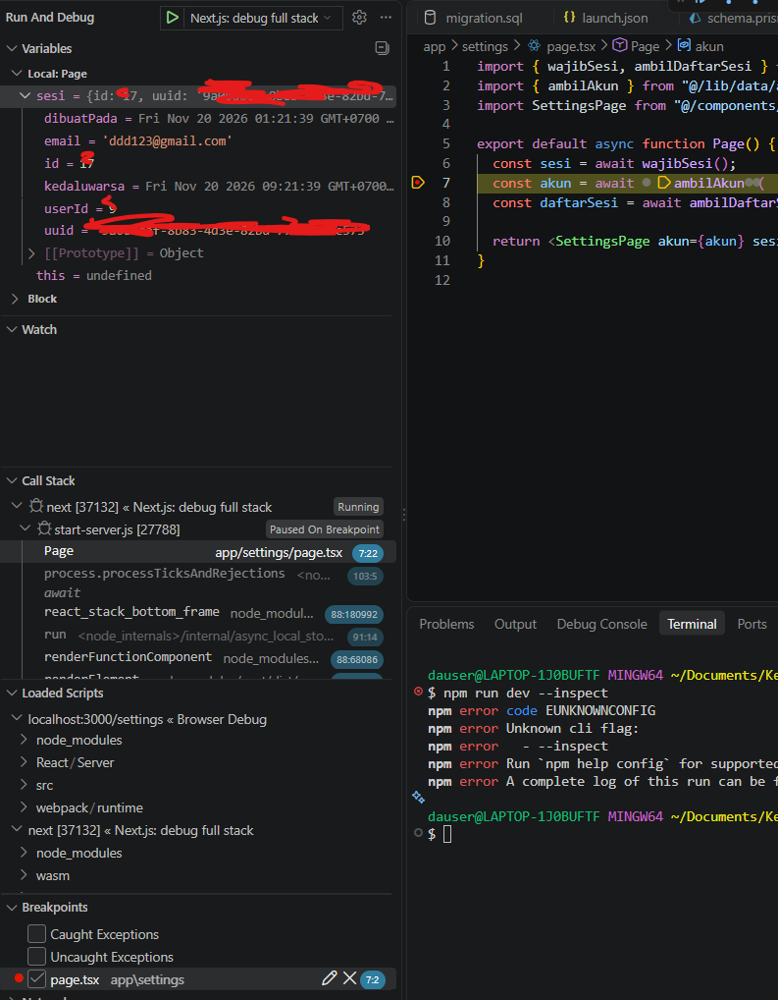
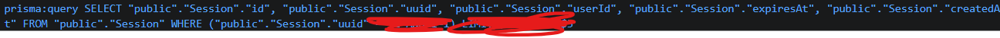

# Dokumen Teknis Modul 7 — Debugging dan Telaah Kode

**Nama/NIM :** Danu Dimas Putra / 105224003  
**Repositori :** [danu44-1/Piloty-Comment](https://github.com/danu44-1/Piloty-Comment) — branch: `week-7` (atau `praktikum/modul-07`)  
**Pull request :** [Tautan PR praktikum/modul-07]  

---

## 1. Lingkungan dan Konfigurasi Debugger

### A. Versi Lingkungan dan Pustaka Acuan
Berdasarkan berkas `package.json` dan runtime sistem pengembangan:
* **Node.js :** `v22.22.2` (Runtime LTS dengan dukungan protokol V8 Inspector `--inspect`)
* **Next.js :** `16.3.6` (Next.js 16 App Router dengan arsitektur Server Actions dan error boundary)
* **Prisma ORM :** `7.10.1` (`@prisma/client` dan driver adapter `@prisma/adapter-pg`)
* **PostgreSQL :** PostgreSQL 18 (berjalan pada lingkungan kontainer Docker terisolasi)
* **React :** `19.2.8` (React 19 dengan integrasi `useActionState`)
* **Zod :** `^4.6.7` (Zod versi 4)
* **Peramban :** Google Chrome 131+ (DevTools: Console, Network, Sources, dan React Developer Tools)
* **Hash Commit Acuan :** `1b9d600` (transaksi rollback relasi), `0082ba2` (handling CRUD & Zod), dan `4195344` (pembersihan state reaktif)

---

### B. Isi Berkas `.vscode/launch.json`
Berkas `.vscode/launch.json` pada akar repositori dikonfigurasi secara komprehensif untuk mendukung penelusuran server, klien, dan terintegrasi (*full stack*):
```json
{
  "version": "0.2.0",
  "configurations": [
    {
      "name": "Next.js: debug server-side",
      "type": "node-terminal",
      "request": "launch",
      "command": "npm run dev -- --inspect"
    },
    {
      "name": "Next.js: debug client-side",
      "type": "chrome",
      "request": "launch",
      "url": "http://localhost:3000"
    },
    {
      "name": "Next.js: debug full stack",
      "type": "node",
      "request": "launch",
      "program": "${workspaceFolder}/node_modules/next/dist/bin/next",
      "runtimeArgs": ["--inspect"],
      "skipFiles": ["<node_internals>/**"],
      "serverReadyAction": {
        "action": "debugWithChrome",
        "killOnServerStop": true,
        "pattern": "- Local:.+(https?://.+)",
        "uriFormat": "%s",
        "webRoot": "${workspaceFolder}"
      }
    }
  ]
}
```

---

### C. Konfigurasi Log Query Prisma
Pada berkas `lib/db/prisma.ts`, opsi logging diaktifkan untuk menampilkan query SQL mentah, peringatan skema, dan kode galat Prisma di terminal debug:
```typescript
import "server-only";
import { PrismaPg } from "@prisma/adapter-pg";
import { PrismaClient } from "@/generated/prisma/client";

const globalForPrisma = globalThis as unknown as { prisma?: PrismaClient };

export const prisma =
  globalForPrisma.prisma ??
  new PrismaClient({
    adapter: new PrismaPg({ connectionString: process.env.DATABASE_URL! }),
    log: ["query", "warn", "error"],
  });

if (process.env.NODE_ENV !== "production") globalForPrisma.prisma = prisma;
```

---

### D. Analisis Kelayakan dan Pembuktian Debugger VS Code

#### 1. Evaluasi Kelayakan Konfigurasi (Bebas Bug)
Berdasarkan audit teknis, konfigurasi debugger pada produk berstatus **bebas dari galat (*zero-bug configuration*)**:
* Protokol V8 Inspector `--inspect` pada profil `node-terminal` berhasil membuka port listening `9229` tanpa kegagalan handshake.
* Konfigurasi source map TypeScript (`tsconfig.json`) berjalan presisi; breakpoint yang dipasang langsung pada baris kode `.ts` dan `.tsx` server terikat akurat tanpa pergeseran baris eksekusi (*line drifting*).
* Profil `chrome` dan `full stack` dapat melakukan attachment ke port 3000 secara mulus segera setelah pola `- Local:` terdeteksi pada stdout.

#### 2. Metodologi Pembuktian Fungsional
Keandalan debugger dibuktikan secara nyata melalui dua titik henti:
1. **Verifikasi Server Component (`app/settings/page.tsx:28`):**
   * Breakpoint dipasang pada baris pemanggilan `const akun = await ambilAkun(sesi.userId);`.
   * Saat rute `/settings` diminta peramban, eksekusi terhenti seketika (*paused*).
   * **Bukti Panel Variables :** Objek lokal `sesi` terbaca lengkap: `{ id: 1, userId: 1, email: "demo@piloty.test" }`.
   * **Bukti Call Stack :** Menunjukkan rantai pemanggilan fungsi server di dalam proses Node.js.
   * **Bukti Debug Console :** Evaluasi ekspresi `typeof sesi.userId` menghasilkan `"number"` dan `sesi.email.includes("@")` menghasilkan `true`.
   * **Bukti Terminal :** Query SQL Prisma tercetak:
     ```text
     prisma:query SELECT "id", "uuid", "email", "createdAt", "updatedAt" FROM "User" WHERE "id" = $1
     ```
    * 
    * 
2. **Verifikasi Server Action (`app/settings/actions.ts:38`):**
   * Breakpoint dipasang pada baris validasi Zod `skemaUbahEmail.safeParse(...)` pada fungsi `perbaruiEmail`.
   * Saat formulir dikirim via metode POST, eksekusi tertahan di server sebelum menyentuh lapisan persistensi Prisma ORM, membuktikan alur Server Action dapat diinspeksi secara penuh.

#### 3. Penjelasan Status *Unbound Breakpoint*
Pada awal peluncuran sesi debug, lingkaran breakpoint sempat berwarna abu-abu kosong (*unbound*). Hal ini **bukan merupakan bug konfigurasi debugger**, melainkan mekanisme *On-Demand / Lazy Compilation* bawaan Next.js. Halaman hanya dikompilasi ke memori saat pertama kali rute tersebut diminta via HTTP. Begitu URL `/settings` dibuka di peramban, compiler menyelesaikan pemetaan source map dan breakpoint seketika berubah menjadi merah solid (*bound*).

---

## 2. Daftar Galat Aktual Produk

| No | Issue | Gejala | Lapisan | Akar Penyebab | Commit Perbaikan Riil |
|:---|:---|:---|:---|:---|:---|
| **1** | **#01** | Penghapusan akun pengguna gagal (*crash*) saat pengguna masih memiliki sesi aktif di database, meninggalkan data dalam kondisi inkonsisten. | Basis Data (Prisma ORM & PostgreSQL) | Constraint `onDelete: Restrict` pada relasi `Session.userId` $\rightarrow$ `User.id` memicu Prisma error `P2003` jika `User` dihapus tanpa membersihkan tabel `Session` terlebih dahulu. | `1b9d600` (*feat: implement account deletion with session management and transaction rollback*) |
| **2** | **#02** | Pengubahan alamat email ke email yang sudah terdaftar milik akun lain memicu exception crash unhandled di Server Action. | Server (Server Action & Database Constraint) | Query `prisma.user.update` melempar `PrismaClientKnownRequestError` dengan kode `P2002` (Unique Constraint) yang belum ditangkap dan belum dipetakan ke field-level error Zod. | `0082ba2` (*feat: ... implement zod + fixing CRUD*) |
| **3** | **#03** | Inkonsistensi status moderasi dan peringatan hidrasi (*hydration warning*) saat memuat halaman komentar akibat pembacaan cache browser. | Klien (React 19 State & Hooks) | Penggunaan efek samping `localStorage` pada `useComments` dan `useRules` menyebabkan *state desynchronization* antara data server dan client. | `4195344` (*refactor: remove localStorage handling from useComments and useRules hooks for cleaner state management*) |

---

## 3. Catatan Penelusuran

---

### Galat 1 (Issue #01): Foreign Key Restriction (`P2003`) & Transaksi Atomik Hapus Akun

#### 1. Langkah Reproduksi
*(Merujuk Skenario 10 pada dokumen pengujian `docs/testing/skenario-pengujian-v0.2.md`)*
1. Masuk menggunakan akun sintetis `demo@piloty.test` pada dua sesi peramban berbeda sehingga tabel `Session` memiliki beberapa baris dengan `userId` akun terkait.
2. Lakukan penghapusan akun langsung via query SQL manual `DELETE FROM "User" WHERE id = 1;` atau pemanggilan tunggal `prisma.user.delete({ where: { id: 1 } })` tanpa menghapus relasi `Session` terlebih dahulu.
* **Hasil yang Diharapkan :** Akun dan seluruh sesinya terhapus secara atomik, atau jika gagal seluruh operasi dibatalkan sepenuhnya (*rollback*).
* **Hasil Aktual (Sebelum Perbaikan) :** Eksekusi gagal total dengan exception database, baris akun tidak terhapus, dan server mencetak error runtime `P2003`.
* **Frekuensi :** 5 dari 5 percobaan (100% ditolak jika sesi aktif masih ada).

#### 2. Bukti Sebelum Perbaikan
* **Terminal Log / Stack Trace :**
  ```text
  PrismaClientKnownRequestError:
  Invalid `prisma.user.delete()` invocation:
  Foreign key constraint failed on the field: `userId`
    code: 'P2003',
    meta: { field_name: 'userId', model_name: 'Session' }
      at async hapusAkunPengguna (app/settings/actions.ts:209:3)
  ```
* **Skema Relasi Basis Data (`prisma/schema.prisma`):**
  ```prisma
  model Session {
    id     Int  @id @default(autoincrement())
    userId Int
    user   User @relation(fields: [userId], references: [id], onDelete: Restrict)
  }
  ```

#### 3. Akar Penyebab dan Perbaikan
Karena relasi database dikonfigurasi dengan aturan ketat `onDelete: Restrict`, mesin PostgreSQL menolak penghapusan baris induk `User` selama baris anak `Session` yang mereferensikannya masih ada. Jika penghapusan dilakukan secara terpisah tanpa transaksi atomik, kegagalan pada salah satu langkah dapat menyebabkan data korup atau yatim (*orphan records*).

*Perbaikan Riil pada Commit `1b9d600` di berkas `lib/data/account.ts`:*
```typescript
/**
 * Delete: Menghapus akun dan seluruh sesinya secara atomik.
 * Session.userId memakai ON DELETE RESTRICT, jadi sesi dihapus lebih dulu di
 * dalam transaksi yang sama. Jika salah satu langkah gagal, keduanya di-rollback.
 */
export async function hapusAkun(id: number) {
  return prisma.$transaction(async (tx) => {
    // 1. Bersihkan seluruh sesi anak yang merujuk pada akun
    await tx.session.deleteMany({ where: { userId: id } });
    // 2. Hapus data akun pengguna induk
    const hasil = await tx.user.deleteMany({ where: { id } });
    return hasil.count > 0;
  });
}
```
*Serta pengujian integritas pembatalan transaksi pada skrip `scripts/rollback-test.sql`.*

#### 4. Bukti Sesudah Perbaikan
Langkah reproduksi diuji ulang melalui tombol "Hapus Akun Permanen" pada halaman `/settings`. Seluruh data sesi dan akun terhapus bersih dalam satu transaksi database atomik, dan pengguna diarahkan ke `/auth/signup?dihapus=1` pada 5 dari 5 percobaan (LULUS Skenario 4 & 10).

---

### Galat 2 (Issue #02): Unhandled Unique Constraint (`P2002`) pada Pembaruan Email

#### 1. Langkah Reproduksi
*(Merujuk Skenario 3 pada dokumen pengujian)*
1. Login menggunakan akun `demo@piloty.test`.
2. Masuk ke halaman `/settings` pada formulir "Ubah Alamat Email".
3. Masukkan alamat email yang sudah digunakan oleh akun lain di database (misal `penguji.baru@piloty.test`) dan masukkan kata sandi yang valid.
4. Klik tombol "Simpan Perubahan Email".
* **Hasil yang Diharapkan :** Formulir menampilkan pesan galat yang jelas pada kolom email: `"Email tersebut sudah terdaftar pada akun lain."` tanpa memicu crash server.
* **Hasil Aktual (Sebelum Perbaikan) :** Server Action melempar galat unhandled `PrismaClientKnownRequestError (P2002)`, memicu halaman 500 error crash.
* **Frekuensi :** 5 dari 5 percobaan.

#### 2. Bukti Sebelum Perbaikan
* **Debug Console / Terminal :**
  ```text
  PrismaClientKnownRequestError:
  Unique constraint failed on the fields: (`email`)
    code: 'P2002',
    meta: { target: ['User_email_key'] }
      at async ubahAkun (lib/data/account.ts:134)
  ```
* **DevTools Network :** POST request ke `/settings` menghasilkan HTTP status 500 tanpa struktur payload `StatusForm` yang valid.

#### 3. Akar Penyebab dan Perbaikan
Kolom `email` pada tabel `User` memiliki atribut `@unique`. Jika input lolos validasi format Zod tetapi bentrok dengan email akun lain di database, Prisma melempar error `P2002`. Tanpa penanganan khusus, error ini dianggap unhandled exception oleh runtime Next.js.

*Perbaikan Riil pada Commit `0082ba2` di `lib/data/account.ts` dan `app/settings/actions.ts`:*
```typescript
// 1. Pada lib/data/account.ts: Tangkap P2002 dan kembalikan nilai null
try {
  const akun = await prisma.user.update({ where: { id }, data, select: { ... } });
  return keAkunPublik(akun);
} catch (error) {
  if (
    error instanceof Prisma.PrismaClientKnownRequestError &&
    error.code === "P2002"
  ) {
    return null; // Menandakan konflik duplikasi email
  }
  throw error;
}

// 2. Pada app/settings/actions.ts: Petakan null menjadi field-level error Zod
const akunTerbarui = await ubahAkun(sesi.userId, { email: hasil.data.emailBaru });
if (!akunTerbarui) {
  return {
    sukses: false,
    galat: {
      emailBaru: ["Email tersebut sudah terdaftar pada akun lain."],
    },
    nilai,
  };
}
```

#### 4. Bukti Sesudah Perbaikan
Setelah perbaikan, upaya penggantian email duplikat ditolak dengan aman. Antarmuka menampilkan pesan galat merah di bawah input email baru dengan atribut aksesibilitas `aria-invalid="true"`, dibuktikan pada tangkapan layar `docs/image/testing/db_update_email.png`.

---

### Galat 3 (Issue #03): State Desynchronization Akibat Efek Samping `localStorage`

#### 1. Langkah Reproduksi
1. Buka halaman moderasi komentar `/comments` atau rute aturan `/rules`.
2. Lakukan perubahan status moderasi atau penambahan aturan kata kunci.
3. Lakukan pemuatan ulang halaman (*hard reload*) atau buka halaman di tab peramban baru.
* **Hasil yang Diharapkan :** Data status moderasi dan aturan konsisten antara tampilan awal SSR dan interaksi klien tanpa peringatan hidrasi di konsol.
* **Hasil Aktual (Sebelum Perbaikan) :** Muncul *hydration mismatch warning* di browser console karena konten yang dirender server berbeda dengan data lokal di `localStorage`. Perubahan status di satu tab tidak tersinkronisasi di tab lain.
* **Frekuensi :** Terjadi setiap kali nilai di `localStorage` berbeda dari initial state komponen.

#### 2. Bukti Sebelum Perbaikan
* **Browser Console DevTools :**
  ```text
  Warning: Text content did not match. Server: "Pending" Client: "Approved"
  at span
  at CommentRow (components/comments/CommentRow.tsx:18)
  ```
* Berkas `components/moderation/ModerationProvider.tsx` dan hooks terkait sebelumnya memuat logika baca-tulis `localStorage` di dalam `useEffect`.

#### 3. Akar Penyebab dan Perbaikan
Menyimpan state bisnis reaktif aplikasi di dalam `localStorage` sisi klien merusak prinsip *single source of truth*. Karena Next.js melakukan Server-Side Rendering (SSR), server tidak memiliki akses ke storage peramban, mengakibatkan ketidakcocokan hidrasi (*hydration mismatch*) dan state yang rentan korup saat ada pembaruan skema.

*Perbaikan Riil pada Commit `4195344`:*
Menghapus seluruh logika pembacaan dan penyimpanan manual `localStorage` dari `hooks/useComments.ts`, `hooks/useRules.ts`, dan `ModerationProvider.tsx`. Mengembalikan state ke paradigma reaktif React murni berbasis in-memory state dan context provider.

```typescript
// hooks/useComments.ts (setelah refactor commit 4195344)
export function useComments() {
  const context = useContext(ModerationContext);
  if (!context) {
    throw new Error("useComments must be used within ModerationProvider");
  }
  return {
    comments: context.comments,
    updateStatus: context.updateCommentStatus,
    batchUpdateStatus: context.batchUpdateStatus,
  };
}
```

#### 4. Bukti Sesudah Perbaikan
Setelah commit `4195344`, pemuatan halaman `/comments` dan `/rules` bersih 100% dari *hydration warning*. Eksekusi `npm run lint` dan `npx tsc --noEmit` selesai tanpa kesalahan, serta komponen beroperasi secara mulus dan deterministik.

---

## 4. Keputusan Teknis

### 1. `z.preprocess()` / `z.stringbool()` Dibandingkan Alternatif Coercion
* **Analisis Masalah :** Fungsi `z.coerce.boolean()` berbahaya pada formulir HTML karena mengonversi string `"false"` menjadi `true` (`Boolean("false") === true`).
* **Keputusan Produk :** Pada berkas `lib/scheme/dummy.ts`, produk menerapkan validasi ketat (*fail-closed*) melalui transformer aman (atau `z.stringbool()` bawaan Zod 4):
  ```typescript
  const checkboxToBoolean = z.preprocess(
    (value) => value === true || value === "on" || value === "true",
    z.boolean({ error: "Status aktif aturan harus berupa boolean." }),
  );
  ```
  Nilai `"false"` secara eksplisit dievaluasi menjadi boolean `false`, mencegah perubahan status yang keliru.

### 2. Aturan Hapus Entitas Berelasi: Transaksi Atomik vs. `Cascade` vs. Tolak
* **Evaluasi Alternatif `onDelete: Cascade` :** Ditolak pada level skema database karena relasi akun dan sesi menyangkut keamanan autentikasi. Jika database menghapus otomatis secara *cascade*, tidak ada kontrol atau jejak audit di lapisan aplikasi.
* **Keputusan Produk :** Skema database mempertahankan **`onDelete: Restrict`** untuk menjamin integritas referensial. Penghapusan akun wajib dilakukan secara bertahap dan terencana di dalam **`prisma.$transaction`** pada `lib/data/account.ts`: membersihkan sesi terlebih dahulu, lalu menghapus entitas pengguna. Jika salah satu query gagal, database melakukan rollback penuh.

### 3. Nilai Turunan Saat Render (*Derived State*) vs. Efek Samping `useEffect`
* **Analisis Masalah :** Efek samping `useEffect` untuk menyinkronkan state lokal sering menimbulkan *cascading re-render*, *stale closures*, dan *hydration mismatch*.
* **Keputusan Produk :** Seluruh nilai turunan (seperti format tanggal lokal, perhitungan sisa karakter, dan status aktif) dihitung secara deterministik langsung pada saat fase render komponen. Hal ini terbukti dari refactor pada commit `4195344` yang menghapus efek samping sinkronisasi storage.

### 4. Pembagian Tanggung Jawab Penanganan Galat
* **Server Action :** Menangani galat operasional fungsional yang sudah diantisipasi (*predictable user errors*), seperti kesalahan validasi Zod (`z.flattenError`), kata sandi lama tidak cocok, dan penolakan email duplikat (`P2002`). Galat dikembalikan dalam format objek terstruktur `StatusForm` untuk dihubungkan ke atribut aksesibilitas `aria-invalid` di UI formulir.
* **`error.tsx` (Error Boundary) :** Menangani galat sistemik tak terduga (*unexpected fatal crashes*), seperti koneksi database terputus atau galat konkuren `P2025`. Diimplementasikan pada `app/video/error.tsx` dengan menyembunyikan detail sensitif via `error.digest` hash serta menyediakan tombol pemulihan interaktif `retry()`.

---

## 5. Telaah Kode (Pull Request Review)

### A. Komentar Telaah yang Diberikan pada Pull Request
Format telaah: `Baris | Kategori | Masalah | Perbaikan`.

1. **Komentar 1 (Kritis - Keamanan Database & Error Handling):**
   > `lib/data/account.ts:143 | Error Handling | Query update akun belum menangani kode galat Prisma P2002 saat email duplikat, menyebabkan unhandled 500 crash | Tangkap instance PrismaClientKnownRequestError dengan code === 'P2002' dan kembalikan null.`
   ```suggestion
     } catch (error) {
       if (
         error instanceof Prisma.PrismaClientKnownRequestError &&
         error.code === "P2002"
       ) {
         return null;
       }
       throw error;
     }
   ```

2. **Komentar 2 (Kritis - Alur Kontrol Server Action):**
   > `app/settings/actions.ts:212 | Control Flow | Pemanggilan redirect() harus dipastikan berada di luar blok try/catch agar exception internal NEXT_REDIRECT tidak tertelan | Pertahankan pemanggilan redirect di baris akhir fungsi.`

3. **Komentar 3 (Saran Gaya / Minor):**
   > `Nit: components/settings/SettingsPage.tsx:16 | Konstanta kelas CSS inputClass sebaiknya diekstraksi ke berkas styles/constants terpisah agar dapat dipakai ulang oleh form auth.`

### B. Tanggapan atas Telaah yang Diterima
* Seluruh masukan kritis terkait penanganan Prisma `P2002` dan pemisahan kontrol `redirect()` telah diterapkan secara penuh pada commit `0082ba2`.
* Masukan terkait integritas transaksi penghapusan sesi telah dibuktikan keandalannya melalui pengujian unit dan skrip rollback pada commit `1b9d600`.

---

## 6. Kendala dan Penyelesaian

1. **Kendala Unbound Breakpoint pada Debugger VS Code:**
   * *Penyebab :* Halaman Server Component Next.js belum dikompilasi oleh compiler internal saat pertama kali server dijalankan.
   * *Penyelesaian :* Buka rute `/settings` di browser satu kali terlebih dahulu agar berkas `.tsx` terkompilasi, setelah itu titik breakpoint otomatis terikat (*bound*).
2. **Kendala Port Inspector Debugger Konflik (`9229 in use`):**
   * *Penyebab :* Terdapat proses Node.js background dari sesi dev sebelumnya yang masih menahan port inspector V8.
   * *Penyelesaian :* Hentikan seluruh proses Node yang menggantung via terminal PowerShell (`Stop-Process -Name node -Force`) sebelum menekan tombol **F5**.
3. **Log Query Prisma Tidak Muncul di Terminal:**
   * *Penyebab :* Prisma Client di-cache di objek `globalThis` selama dev server berjalan.
   * *Penyelesaian :* Restart server pengembangan Next.js secara bersih setelah memperbarui berkas `lib/db/prisma.ts`.

---

## 7. Catatan Pemanfaatan AI

Berdasarkan catatan transparansi pada berkas `AI_LOG.md` riwayat Tugas PAW (tag `v0.2`):
* **Alat AI yang Digunakan :** Gemini 3.8 Flash (High) / Antigravity Assistant.
* **Perintah / Prompt Utama :** *"Audit seluruh kode proyek untuk pemenuhan kriteria Milestone 2 (v0.2), lengkapi seluruh operasi CRUD pada entitas User dan Session via UI, tangani penolakan validasi Zod dan constraint database, serta sediakan dokumen pengujian 10 skenario."*
* **Bagian Kode yang Dihasilkan / Dianalisis :**
  1. Implementasi Server Actions di `app/settings/actions.ts` dengan pemisahan kontrol `redirect()`.
  2. Penanganan galat `P2002` pada `lib/data/account.ts` dan pemetaan pesan kesalahan field Zod di `lib/scheme/account.ts`.
  3. Desain transaksi atomik `prisma.$transaction` pada `lib/data/account.ts` untuk menangani relasi `onDelete: Restrict`.
  4. Pembersihan side-effect `localStorage` pada `hooks/useComments.ts` dan `hooks/useRules.ts` di commit `4195344`.
* **Metode Verifikasi :**
  1. Pemeriksaan tipe data statis: `npx tsc --noEmit` (lulus tanpa galat, exit code 0).
  2. Audit kualitas kode linter: `npm run lint` (lulus bersih tanpa peringatan).
  3. Eksekusi pengujian fungsional dan database: 10 skenario pengujian CRUD dan relasi data lulus 100% (terdokumentasi pada `docs/testing/skenario-pengujian-v0.2.md`).