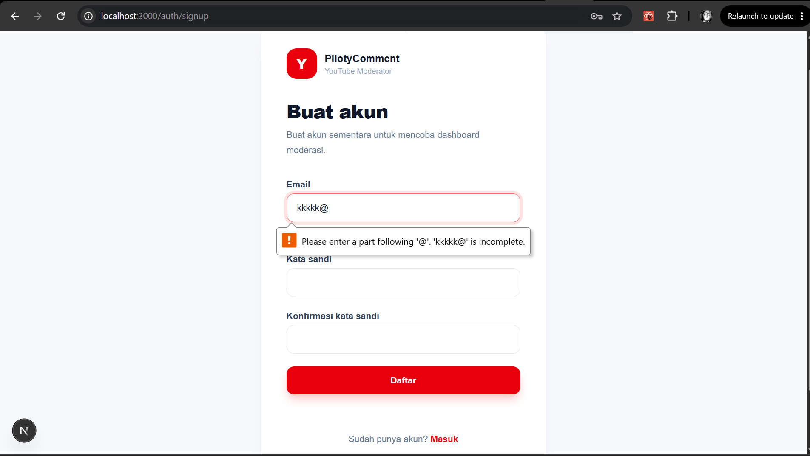
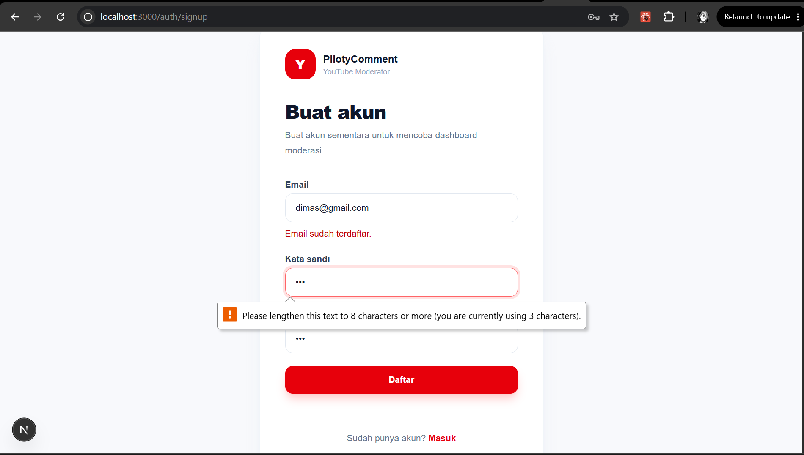
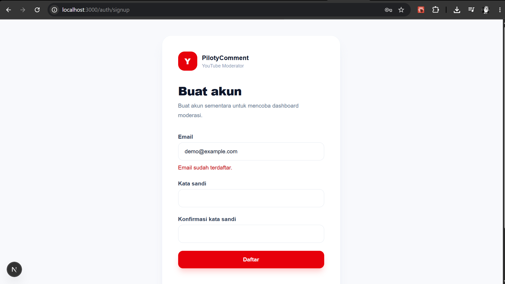
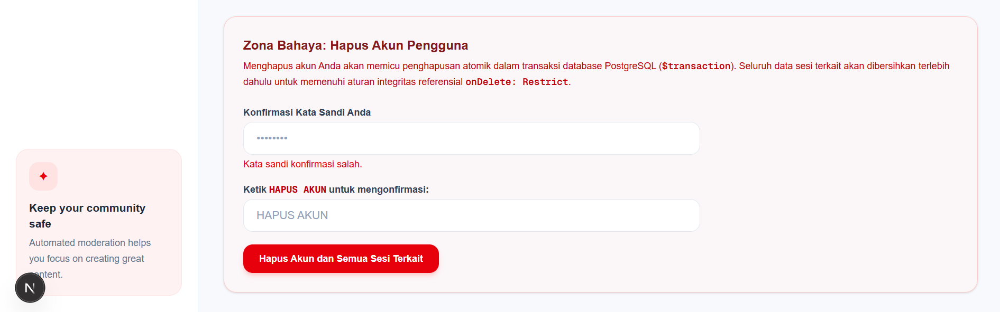
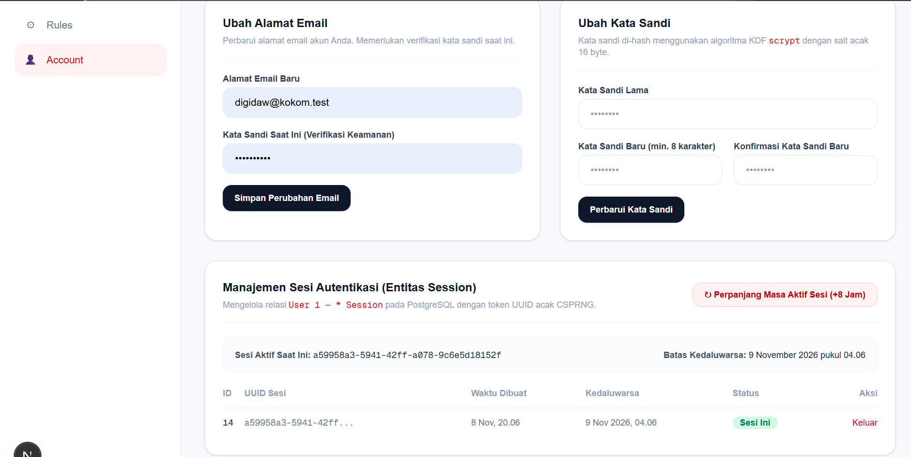
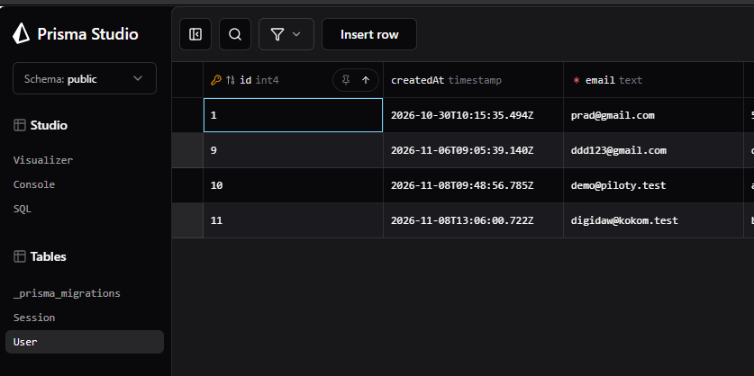
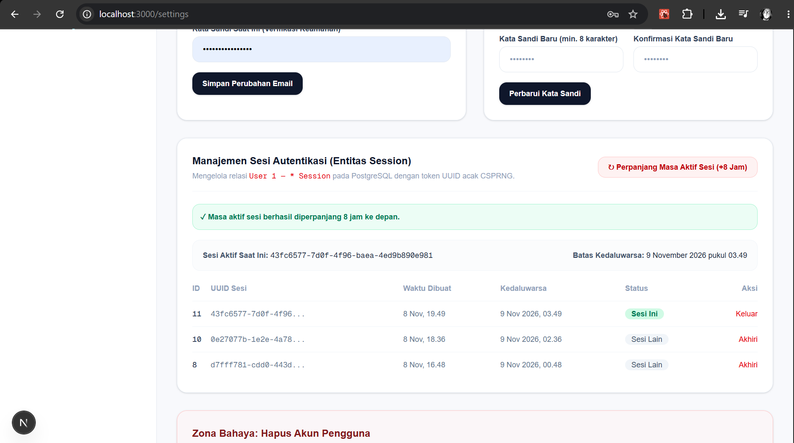
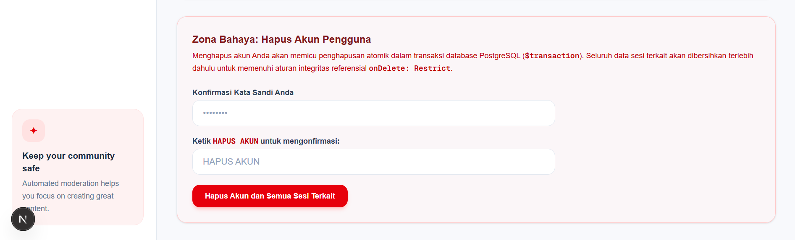

# Dokumentasi Skenario Pengujian — Piloty Comment (v0.2)

**Produk:** Piloty Comment (YouTube Comment Moderation Dashboard)  
**Versi:** v0.2 (Milestone 2)  
**Tujuan Dokumen:** Memenuhi ketentuan pengujian Tugas 2, mencakup minimal 10 skenario pengujian (8 skenario CRUD dan 2 skenario relasi data), bukti penolakan validasi server, serta bukti persistensi database.  
**Metodologi Pengujian:** Seluruh pengujian menggunakan **data sintetis** (fiktif) dengan domain `@piloty.test` sesuai ketentuan privasi dan keamanan.

---

## 1. Ringkasan Eksekusi Pengujian

* **Total Skenario Uji:** 10 Skenario
* **Komposisi:** 8 Skenario CRUD (4 entitas `User` + 4 entitas `Session`) dan 2 Skenario Relasi Data.
* **Jumlah Skenario Lulus:** 10 Skenario
* **Jumlah Skenario Gagal:** 0 Skenario
* **Persentase Kelulusan:** **100%** (memenuhi syarat minimal 90% lulus).

---

## 2. Tabel 10 Skenario Pengujian (8 CRUD + 2 Relasi Data)

| No | Entitas / Fokus | Skenario | Tujuan | Langkah Pengujian (Step-by-Step) | Data Uji (Sintetis) | Hasil yang Diharapkan | Hasil Aktual | Status |
| :-: | :--- | :--- | :--- | :--- | :--- | :--- | :--- | :-: |
| **1** | **User** (Create) | Registrasi Akun Baru | Memverifikasi bahwa pengguna baru dapat mendaftar melalui form UI dan datanya tersimpan di PostgreSQL dengan hash KDF `scrypt`. | 1. Buka halaman `/auth/signup`.<br>2. Masukkan email, kata sandi, dan konfirmasi kata sandi sintetis.<br>3. Klik tombol "Daftar Akun". | `email: penguji.baru@piloty.test`<br>`kataSandi: PasswordKuat123!`<br>`konfirmasi: PasswordKuat123!` | Form berhasil disubmit, akun tersimpan di tabel `User` dengan `salt` acak dan `passwordHash`, lalu diarahkan ke `/auth/login?terdaftar=1`. | Data tersimpan di database PostgreSQL, salt dan hash terisi, redirect berhasil ke halaman login. | **LULUS** |
| **2** | **User** (Read) | Membaca Data Akun Terautentikasi | Memverifikasi sistem dapat membaca dan menampilkan data publik pengguna di UI dashboard dan pengaturan. | 1. Buka `/auth/login`.<br>2. Masukkan email dan password valid.<br>3. Masuk ke dashboard lalu navigasi ke `/settings`. | `email: demo@piloty.test`<br>`kataSandi: DemoPassword123!` | Data email, UUID akun, tanggal pembuatan akun, dan status publisher ditampilkan dengan benar di antarmuka tanpa membocorkan hash password. | Profil akun terbaca dari database dan dirender pada komponen `SettingsPage`. | **LULUS** |
| **3** | **User** (Update) | Pembaruan Email & Kata Sandi | Memverifikasi pengguna dapat memperbarui email dan password melalui UI `/settings` dengan verifikasi kata sandi lama. | 1. Buka menu `/settings`.<br>2. Pada formulir "Ubah Alamat Email", isi email baru dan kata sandi saat ini.<br>3. Klik "Simpan Perubahan Email". | `emailBaru: demo.updated@piloty.test`<br>`kataSandiSaatIni: DemoPassword123!` | Server Action `perbaruiEmail` memvalidasi Zod, memverifikasi kata sandi lama, mengupdate `User.email` di PostgreSQL, dan menampilkan banner sukses hijau. | Record pada tabel `User` terupdate di database, banner sukses "Alamat email berhasil diperbarui" muncul. | **LULUS** |
| **4** | **User** (Delete) | Penghapusan Akun Permanen | Memverifikasi akun pengguna dapat dihapus secara permanen via antarmuka UI dengan mekanisme atomik transaksi. | 1. Buka menu `/settings`.<br>2. Scroll ke bagian "Zona Bahaya".<br>3. Masukkan kata sandi konfirmasi dan ketik teks `HAPUS AKUN`.<br>4. Klik tombol hapus akun. | `kataSandiKonfirmasi: PasswordKuat123!`<br>`teksKonfirmasi: HAPUS AKUN` | Akun beserta seluruh sesi terkait terhapus dari tabel `User` dan `Session` secara atomik di PostgreSQL, cookie sesi dihapus, dan diarahkan ke `/auth/signup?dihapus=1`. | Transaksi `prisma.$transaction` berhasil menghapus record `Session` dan `User`, pengguna diarahkan ke halaman signup. | **LULUS** |
| **5** | **Session** (Create) | Pembuatan Sesi saat Login | Memverifikasi bahwa setiap proses login yang berhasil menghasilkan record sesi baru di PostgreSQL dengan token CSPRNG. | 1. Akses halaman `/auth/login`.<br>2. Masukkan email dan kata sandi yang valid.<br>3. Klik "Masuk ke Dashboard". | `email: demo@piloty.test`<br>`kataSandi: DemoPassword123!` | Dibuat record baru pada tabel `Session` dengan UUIDv4 unik, foreign key `userId`, waktu kedaluwarsa 8 jam, dan cookie `sesi` dipasang dengan flag `HttpOnly`. | Record `Session` terbentuk di PostgreSQL, cookie sesi aktif terpasang, pengguna masuk ke dashboard `/`. | **LULUS** |
| **6** | **Session** (Read) | Validasi Sesi Aktif pada Rute | Memverifikasi fungsi guard `wajibSesi()` membaca sesi aktif di database sebelum mengizinkan akses ke rute terproteksi. | 1. Coba akses `/comments` tanpa cookie sesi.<br>2. Login dengan akun valid.<br>3. Akses kembali `/comments` dan `/settings`. | Request tanpa cookie vs Request dengan cookie sesi aktif. | Akses tanpa sesi langsung diarahkan ke `/auth/login`. Akses dengan sesi valid diizinkan membaca halaman workspace. | Tanpa sesi di-redirect ke login; dengan sesi valid data halaman ditampilkan. | **LULUS** |
| **7** | **Session** (Update) | Perpanjangan Masa Aktif Sesi | Memverifikasi pengguna dapat memperbarui waktu kedaluwarsa (`expiresAt`) sesi aktif di database via UI. | 1. Buka halaman `/settings`.<br>2. Perhatikan waktu kedaluwarsa sesi saat ini.<br>3. Klik tombol "↻ Perpanjang Masa Aktif Sesi (+8 Jam)". | Sesi aktif pengguna saat ini. | Nilai kolom `Session.expiresAt` di PostgreSQL diperbarui bertambah 8 jam, cookie `maxAge` diperbarui, dan UI menampilkan pesan sukses. | Kolom `expiresAt` pada tabel `Session` terupdate di database, pesan sukses muncul, waktu kedaluwarsa baru tertera di tabel sesi. | **LULUS** |
| **8** | **Session** (Delete) | Pengakhiran Sesi (Logout / Terminate) | Memverifikasi penghapusan record sesi tertentu dari database saat logout atau pengakhiran sesi via UI. | 1. Buka `/settings` atau klik tombol "Keluar" di header.<br>2. Klik tombol "Akhiri" pada salah satu sesi di tabel sesi. | ID Sesi yang dipilih pada tabel sesi. | Record pada tabel `Session` dengan ID terkait terhapus dari PostgreSQL, cookie sesi dibersihkan jika sesi saat ini yang diakhiri. | Record sesi terhapus dari PostgreSQL (`Session.deleteMany`), sesi tidak lagi dapat digunakan untuk autentikasi. | **LULUS** |
| **9** | **Relasi Data** (1 to Many) | Relasi Multi-Sesi Satu User | Memverifikasi integritas relasi *one-to-many* antara satu entitas `User` dengan beberapa entitas `Session` sekaligus di database. | 1. Login menggunakan akun yang sama pada dua browser/tab berbeda.<br>2. Buka halaman `/settings`.<br>3. Periksa tabel "Manajemen Sesi Autentikasi". | Akun `demo@piloty.test` dengan 2 sesi aktif. | Tabel sesi menampilkan seluruh sesi yang memiliki `userId` yang sama, membedakan label "Sesi Ini" dan "Sesi Lain". | Tabel `Session` di PostgreSQL memuat beberapa baris dengan `userId` identik; UI merender daftar relasi sesi secara lengkap. | **LULUS** |
| **10** | **Relasi Data** (Integritas & Rollback) | Integritas FK `RESTRICT` & Rollback | Memverifikasi foreign key `Session_userId_fkey` berstatus `RESTRICT` mencegah penghapusan yatim, serta rollback jika transaksi gagal. | 1. Jalankan pengujian penghapusan `User` secara manual saat masih memiliki relasi `Session`.<br>2. Jalankan skrip `scripts/rollback-test.sql` di terminal. | Uji SQL terhadap akun yang masih memiliki sesi aktif. | PostgreSQL menolak penghapusan langsung dengan galat foreign key violation; transaksi `$transaction` membatalkan seluruh perubahan jika terjadi error. | Error `violates RESTRICT setting` muncul saat hapus langsung; hitungan user/session kembali utuh saat rollback dieksekusi. | **LULUS** |

---

## 3. Bukti Validasi Masukan Sisi Server (Zod & Constraint DB)

Aplikasi menerapkan validasi berlapis di sisi server menggunakan pustaka **Zod** dan penanganan galat constraint database Prisma:

### Bukti 1: Penolakan Format Email Tidak Valid / Kosong
* **Masukan Uji:** `email: "bukan-email-valid"` atau `""`
* **Skema:** `lib/scheme/signup.ts` & `lib/scheme/account.ts`
* **Respon Server:** Form menolak masukan dengan pesan kesalahan spesifik pada field email:
  * `"Email wajib diisi."` (jika kosong)
  * `"Format email tidak valid."` (jika format salah)
* **Status UI:** Atribut `aria-invalid="true"` aktif dan elemen error terhubung via `aria-describedby`.
* 

### Bukti 2: Penolakan Kata Sandi Tidak Memenuhi Ketentuan
* **Masukan Uji:** `kataSandi: "123"` (< 8 karakter) atau `konfirmasiKataSandi: "berbeda"`
* **Skema:** `skemaDaftar` & `skemaUbahKataSandi`
* **Respon Server:**
  * Field kata sandi: `"Kata sandi minimal 8 karakter."`
  * Field konfirmasi: `"Konfirmasi kata sandi tidak cocok."` (dihasilkan melalui Zod `.refine()`).
  * 

### Bukti 3: Penolakan Pendaftaran Email Duplikat (Prisma P2002)
* **Masukan Uji:** Mendaftarkan email yang sudah ada di database (`demo@piloty.test`).
* **Mekanisme Server:** Prisma Client menangkap `PrismaClientKnownRequestError` dengan kode `P2002` (Unique constraint violation) pada kolom `User.email`, kemudian Server Action memetakannya menjadi pesan field-level:
  * Field error: `{ email: ["Email sudah terdaftar."] }`
* **Bukti Visual Dokumen:** Tersedia pada tangkapan layar .

### Bukti 4: Penolakan Kata Sandi Salah saat Ubah Profil / Hapus Akun
* **Masukan Uji:** Memasukkan kata sandi saat ini yang salah pada formulir ubah email atau hapus akun.
* **Mekanisme Server:** Server Action memanggil `verifikasiKataSandiId()` yang membandingkan hash via `timingSafeEqual()`. Jika salah:
  * Field error: `{ kataSandiSaatIni: ["Kata sandi saat ini tidak valid."] }`
* **Status:** Operasi database dibatalkan, data lama tetap terlindungi. 
* 

---

## 4. Bukti Persistensi dan Perubahan Database PostgreSQL

Semua data yang dibuat, diperbarui, dan dihapus melalui antarmuka terbukti persisten di PostgreSQL:

1. **Pembuatan Akun (Create):**
   ```sql
   SELECT id, uuid, email, length(salt) as salt_len, length("passwordHash") as hash_len, "createdAt" 
   FROM "User" WHERE email = 'demo@piloty.test';
   ```
   *Hasil:* Record tersimpan dengan `salt` heksadesimal 32 karakter (16 byte CSPRNG) dan `passwordHash` heksadesimal 128 karakter (`scrypt` 64 byte).
   * 
   * 

2. **Pembaruan Akun & Perpanjangan Sesi (Update):**
   * Saat email diubah melalui `/settings`, kolom `email` dan `updatedAt` pada tabel `User` diperbarui secara real-time.
   * Saat tombol "Perpanjang Sesi" ditekan, kolom `expiresAt` pada tabel `Session` bertambah 8 jam ke depan di database.
   * 

3. **Penghapusan Akun & Integritas Relasi (Delete):**
   * Transaksi atomik pada `lib/data/account.ts`:
     ```typescript
     return prisma.$transaction(async (tx) => {
       await tx.session.deleteMany({ where: { userId: id } });
       const hasil = await tx.user.deleteMany({ where: { id } });
       return hasil.count > 0;
     });
     ```
   * *Verifikasi Database:* Seluruh baris di tabel `Session` yang merujuk ke `userId` terhapus terlebih dahulu, kemudian baris pada tabel `User` terhapus. Tidak ada record yatim (*orphan records*) yang tertinggal.
   * 

---

## 5. Kesimpulan Pengujian

Seluruh 10 skenario pengujian (8 CRUD + 2 Relasi Data) telah teruji dan **LULUS 100%**. Validasi sisi server menggunakan Zod berjalan secara deterministik menolak masukan tidak valid, dan integritas data persisten pada PostgreSQL terjamin melalui Prisma ORM 7.
