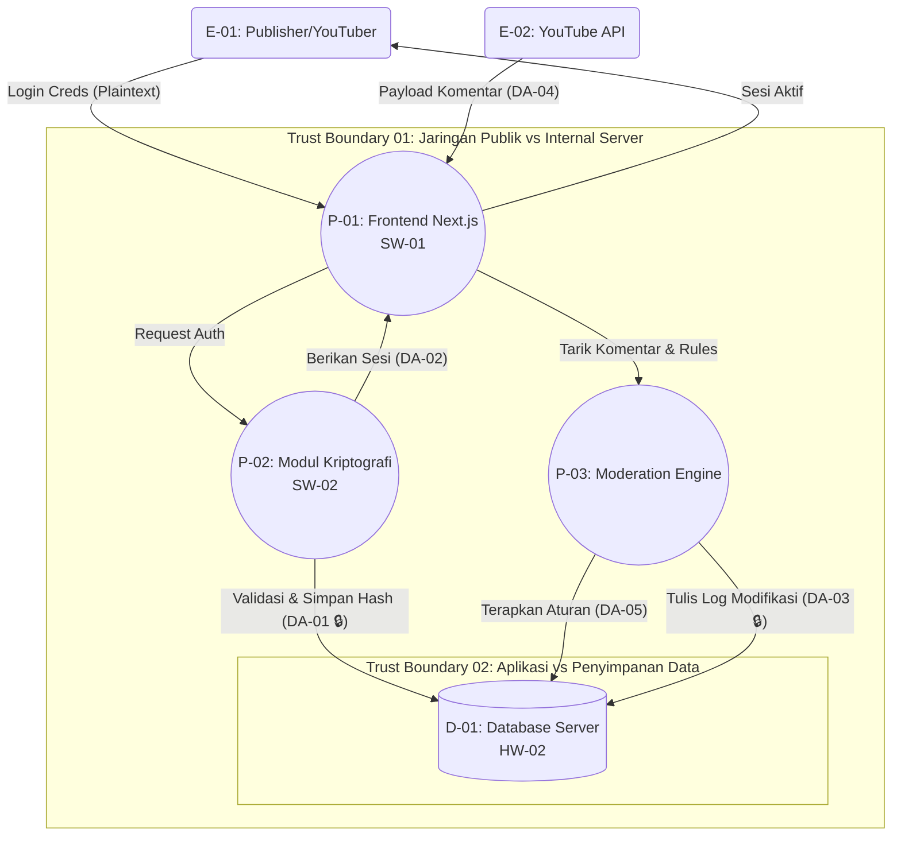

# Data Flow Diagram (DFD) - Piloty Comment

Diagram ini memetakan aliran data pada sistem Piloty Comment, termasuk identifikasi elemen, aset yang terlibat, dan *Trust Boundary* (Batas Kepercayaan).

## Representasi DFD (Mermaid)

## Daftar Elemen DFD
*   **E-01 (Entitas Eksternal): Publisher** - Pengguna tunggal yang mengakses dashboard via peramban.
*   **E-02 (Entitas Eksternal): YouTube API** - Sumber data komentar eksternal.
*   **P-01 (Proses): Frontend Next.js** - Antarmuka UI (SW-01) yang berinteraksi dengan pengguna.
*   **P-02 (Proses): Modul Kriptografi & Auth** - Modul (SW-02) yang memproses hash (PBKDF2) dan verifikasi identitas.
*   **P-03 (Proses): Moderation Engine** - Logika bisnis untuk memindai komentar terhadap aturan moderasi.
*   **D-01 (Data Store): Database Server** - Tempat persisten penyimpanan aset DA-01 hingga DA-05 (HW-02).

## Trust Boundaries
1.  **TB-01 (Internet / Jaringan Publik ke Server Aplikasi):** Batas antara internet terbuka tempat E-01 dan E-02 berada dengan server aplikasi internal (HW-01). Ini merupakan titik paparan tertinggi untuk serangan eksternal.
2.  **TB-02 (Server Aplikasi ke Database):** Batas antara aplikasi web dengan tempat penyimpanan data (HW-02). Meskipun berada di backend yang sama, database harus diproteksi dari kerentanan aplikasi (misal: SQL Injection).

*(Catatan: 🔒 menandakan aset data yang dilindungi oleh mekanisme kriptografi).*